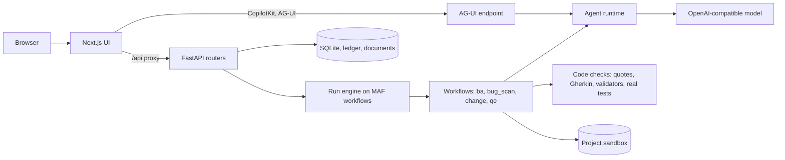

# Agentic QE Platform

A governed workspace for business analysts and developers, built on Microsoft Agent Framework (MAF) in Python with a Next.js UI. It turns briefs into templated requirements and Gherkin, reviews complete repositories for bugs, builds features and fixes on separate branches, and runs a full test lifecycle with a named person approving each stage.

## Features

| Area | What it does |
|---|---|
| Projects | One page per project, with search, rename, archive, and delete. Every tile and card opens its tab |
| Repository and sandbox | Git, private GitHub, ZIP, or local folder. Each project gets a sandbox with a full clone, a branch per run, and its own Python environment |
| BA Studio | Requirements from built-in or uploaded templates, with an independent review and validated Gherkin |
| Documents | Formatted pages edited in place, with table grids and images. Immutable versions, diffs, restore, and downloads as `.md`, `.docx`, `.feature`, and `.csv` |
| Bug Scan | Static scanners and an agent review of every source file, with coverage reported. Findings must quote real code. Fix one or Fix all |
| Feature Builder | Changes on a branch, checked against a test baseline. You review the diff and verdict before commit |
| QE Studio | Requirements, plan, design, generated tests, execution, healing, and traceability, through gates G0 to G5, shown live |
| Copilot | AG-UI and CopilotKit chat with saved threads, project memory, and selectable agents |
| Accounts | Admin login from `.env`. Each user has a password, a role (QE lead, BA, developer, or viewer), the models they may use, token limits, active dates, and project members. Users see only their own projects and the ones they are added to |
| Models and limits | Several models on one endpoint, each with a test. Daily, weekly, monthly, and per-model token limits reset on a schedule in one time zone |
| Errors and recovery | Typed error codes, each with the action to take. Retry failed stage resumes from saved batches. Rejected model replies are saved for diagnosis |
| Confidence review | An independent review runs beside each stage. Code can lower the score. A code change's review is capped at 60 when its tests fail |
| Agents | 11 agents, named as in the agentic-qe plugin, shown as cards, each with its own page: tool policy, kill switch, token limits, guardrails, and evaluations |
| Observability | Skills, agents, tools, workflow steps, approvals, guardrails, and the audit ledger, by run, project, or all projects. A daily application log that the admin can download |
| Documentation | A built-in docs site at `/docs`, with search |

## Quick start

You need Python 3.12+, Node.js 20+, Git, and an OpenAI-compatible model endpoint.

Double-click `start-windows.bat` on Windows or `start-mac.command` on macOS. The first run installs everything, then the app opens in your browser. Press Ctrl+C in that window to stop it. If macOS blocks the file, right-click it and choose **Open**.

From a terminal, the same thing is:

```bash
python scripts/dev.py up
```

Before the first start, add the admin login to `.env`, or nobody can sign in:

```text
ATLAS_ADMIN_USERNAME=your-admin-name
ATLAS_ADMIN_PASSWORD=a-long-unique-password
```

Then sign in, open **Settings**, enter the model details, and choose **Test connection**. Under **Models**, choose **Load from proxy**, then test each model before you switch it on. Create users under **Users**, and tick the models each one may use.

### Development with live reload

Run these in two terminals:

```bash
python scripts/dev.py backend
```

```bash
python scripts/dev.py frontend
```

## Architecture



Each agent, tool, workflow, and API area has its own file. To add an agent or workflow, add a file. See `docs/SYSTEM_DESIGN.md`.

## Project layout

| Path | Holds |
|---|---|
| `src/backend/api` | REST routers, one file per area |
| `src/backend/maf/agents` | One file per agent, holding its policy |
| `src/backend/maf/tools` | One file per tool |
| `src/backend/maf/workflows` | One file per workflow |
| `src/backend/maf` | Agent runtime, engine, governance, observability, evals, AG-UI, model client |
| `src/backend/core` | Documents, gates, ledger, prompts, security |
| `src/backend/repos` | Git, GitHub, ingest, sandbox, scan, static analysis |
| `src/backend/qe` | Validators, runners, traceability |
| `src/frontend` | Next.js pages, components, and documentation content |
| `prompts`, `evals`, `templates` | Agent prompts, agent eval cases, document templates |
| `tests` | Unit, integration, and Playwright tests |
| `deploy/azure`, `scripts` | App Service startup, launcher, packaging, hooks |
| `docs` | Design, Azure guide, roadmap, file map, test screenshots |

`docs/PROJECT_STRUCTURE.md` lists every file, what it does, and what uses it. It is generated from the real imports by `python scripts/gen_structure.py`.

## Test

These run offline with real FastAPI, SQLite, Git, and pytest, and a scripted stand-in for the model:

```bash
python scripts/dev.py test
```

These use the real model, real repositories, and a real browser on ports 8010 and 3010, and save screenshots to `docs/evidence`:

```bash
python scripts/dev.py e2e
```

`tests/e2e/test_finance_repo.py` runs every feature on [personal-finance-mcp](https://github.com/sarveshtalele/personal-finance-mcp) by adding a new MCP tool. CI runs the offline tests on Windows, macOS, and Linux.

### Latest results

| Check | Result |
|---|---|
| Offline tests | 447 passed |
| End-to-end tests (real model, repository, browser) | 32 of 33 passed. `test_f4` failed: Feature Builder ended with a failing test verdict, which happens in some runs |
| Agent evaluations (real model) | 33 of 33 passed. Skill cases that need a judge wait until one is set |
| QE run on the finance repository | 56 tests executed, 14 passed, 42 failed, coverage 53%, verdict FAIL, 446,876 tokens. Results vary widely between runs |

CI status for this commit: not yet confirmed.

The end-to-end suite checks that the platform runs every stage. It does not mean the generated tests all pass. The 48 failures stay reported as failures. Generated tests vary a lot between runs, so these numbers move. Improving them is phase 5 of `docs/PLUGIN_AND_UI_PLAN.md`.

## Roadmap

Phases 1 to 6 of `docs/PLUGIN_AND_UI_PLAN.md` are done: names and integrity, errors and logs, models, limits, and access, skills, accuracy, and evaluations. Phase 7, repository-aware changes and tested ZIP delivery, is next. Everything below is planned, and not built.

| Item | Purpose |
|---|---|
| Skill Studio | Create and manage skills that agents use |
| Repository-aware changes with tested ZIP delivery | Change a repository, test it, and hand back a ZIP |
| Application builder from BA documents | Build an application from approved BA documents |
| Chatbot | A reworked project chat, with a card for each feature and a live run card |
| New UI | A new design system and upgraded components |

## Deploy to Azure

```bash
python scripts/package_azure.py
```

Azure has not been deployed for real yet. This makes separate backend and frontend ZIPs in `dist/`. With `--repo`, it also makes a clean copy of the project in `dist/agentic-qe-platform`. `docs/AZURE_DEPLOY.md` has the portal steps and costs: about ₹1,182 a month on one Basic B1 Linux plan in East US 2, at retail prices checked on 1 November 2026.

## Documents

| File | Contents |
|---|---|
| `docs/SYSTEM_DESIGN.md` | End-to-end design, and how to add agents, tools, and workflows |
| `docs/PROJECT_STRUCTURE.md` | Every file, its purpose, and how it connects |
| `docs/AZURE_DEPLOY.md` | Azure deployment with the portal and ZIPs |
| `docs/AZURE_SYSTEM_DESIGN.md` | Multi-user Azure design: storage, sandboxes, and costs in East US 2 |
| `docs/ARCHITECTURE.md` | Plugin mapping and workflow details |
| `docs/PLUGIN_AND_UI_PLAN.md` | Approved plan. Phases 1 to 6 are built, and the rest is not built yet |
| `maf-guide.md` | MAF features used, by file |
| `plan.md`, `specs.md`, `tasks.md` | Decisions, requirements, status |
| `Design.md` | UI design rules |
| `CLAUDE.md` | Rules for changing this project |
| `progress.md` | Timestamped activity log |

## Security limits

- Everyone signs in. Passwords are salted hashes, and logs mask login details. Use HTTPS outside your own machine, and keep the backend private with an access restriction, as the Azure guide describes.
- A project sandbox isolates by folder and environment, and is not an operating system container, so it is not safe for untrusted users yet. `docs/AZURE_SYSTEM_DESIGN.md` has the design that is. Tick **Install repository dependencies** only for repositories you trust, because that runs their install scripts.
- Keys are encrypted at rest and redacted from logs. Keep `data/` private.
