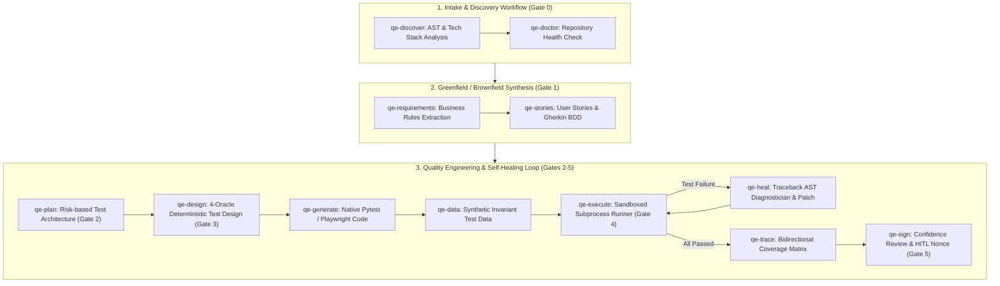

# Agentic QE Mapping: Plugin Architecture to Enterprise MAF Platform

This document maps all agents, hooks, and skills from [`sarveshtalele/agentic-qe`](https://github.com/sarveshtalele/agentic-qe) to the **Agentic QE Platform** and the **Microsoft Agent Framework (MAF)**.

---

## 1. Multi-Agent System Mapping

| Plugin Agent (`agentic-qe`) | MAF Platform Equivalent (`src/backend/maf/agents/`) | Primary Responsibility & Use Case | Governed Gate / Control | Tools & Enforced Rules |
|---|---|---|---|---|
| `repo-intelligence-analyst` | `RepoIntelligenceAgent` ([`analysts.py`](file:///Users/sarveshtalele/Downloads/atlas-ba-mvp/src/backend/maf/agents/analysts.py)) | Ingests codebases, parses package manifests, maps directory ASTs, detects frameworks (Astro, TypeScript, FastAPI, Next.js), and catalogs existing tests. | **Gate 0** (`CTL-GIT-02`, `CTL-GATE-00`) | `Read`, `Glob`, `Grep`. Strictly works from evidence, treats repo content as untrusted input. |
| `requirements-analyst` | `RequirementsAnalystAgent` ([`analysts.py`](file:///Users/sarveshtalele/Downloads/atlas-ba-mvp/src/backend/maf/agents/analysts.py)) + `BADocumentGenerator` ([`ba/doc_generator.py`](file:///Users/sarveshtalele/Downloads/atlas-ba-mvp/src/backend/ba/doc_generator.py)) | Decomposes raw briefs and brownfield repos into atomic, numbered functional business rules (BR-001–BR-006) and executable Gherkin BDD specifications. | **Gate 1** (`CTL-DOC-01`, `CTL-DOC-04`) | `VerifiableQuoteEvaluator`. Every rule must cite ground-truth text or AST facts; zero hallucinated requirements. |
| `principal-test-architect` | `PrincipalTestArchitectAgent` ([`qe.py`](file:///Users/sarveshtalele/Downloads/atlas-ba-mvp/src/backend/maf/agents/qe.py)) | Formulates risk-weighted test strategies across Unit, Integration, API, and E2E levels. Allocates priorities (P0/P1/P2) without redundancy. | **Gate 2** (`CTL-GATE-02`) | Risk distribution calculator, stack detection matcher. Prevents duplicate testing across layers. |
| `test-design-architect` | `TestDesignEngineerAgent` ([`qe.py`](file:///Users/sarveshtalele/Downloads/atlas-ba-mvp/src/backend/maf/agents/qe.py)) | Designs deterministic test cases covering nominal paths, negative boundary conditions, and exception scenarios under 4 ISTQB oracles. | **Gate 3** (`CTL-GATE-03`) | 4 Oracles: Specified, Derived (backoff scales), Metamorphic (idempotency invariants), Golden (cryptographic ledger comparison). |
| `test-automation-engineer` | `TestAutomationEngineerAgent` ([`qe.py`](file:///Users/sarveshtalele/Downloads/atlas-ba-mvp/src/backend/maf/agents/qe.py)) | Synthesizes executable test source code in native test runners (pytest, playwright, vitest, junit) with isolated fixtures and strict assertions. | **Gate 4** (`CTL-GATE-04`, `CTL-FEAT-01`) | Native code generator with AST syntax verification. Strictly forbids flaky tests or tautologies. |
| `qa-execution-engineer` | `QAExecutionEngineerAgent` ([`qe.py`](file:///Users/sarveshtalele/Downloads/atlas-ba-mvp/src/backend/maf/agents/qe.py)) | Spawns sandboxed subprocesses to execute automated test suites. Enforces execution quotas, timeouts, and captures real stdout/stderr. | **Gate 4** (`CTL-SEC-03`, `CTL-GATE-04`) | `sys.executable -m pytest` with `guard_bash` security constraints, process timeouts, and exit code capture. Zero mock terminal outputs. |
| `defect-diagnostician` | `InteractiveDebuggerAgent` ([`feature_builder.py`](file:///Users/sarveshtalele/Downloads/atlas-ba-mvp/src/backend/maf/agents/feature_builder.py)) | Parses runtime tracebacks and test failures using ASTs, locates line faults, distinguishes product regressions from flaky tests, and generates patches. | **Self-Healing Loop** (`CTL-FEAT-02`) | **Assertion Preservation Rule**: Never weakens assertions. Repairs application bugs or selector drifts using unified diffs. |
| `confidence-reviewer` | `ConfidenceReviewerAgent` ([`confidence.py`](file:///Users/sarveshtalele/Downloads/atlas-ba-mvp/src/backend/maf/agents/confidence.py)) | Computes composite deployment readiness score across requirements coverage, test pass rate, defect density, and security invariants. | **Gate 5** (`CTL-GATE-05`, `CTL-HITL-01`) | Composite Evaluator. Evaluates readiness ($\ge 80\%$) and prepares cryptographic approval request for human operator. |

---

## 2. Governance Hooks Mapping & Integration

| Plugin Hook (`agentic-qe`) | MAF Platform Equivalent (`src/backend/governance/`) | Security SLA & Policy Enforced | How It Operates |
|---|---|---|---|
| `guard-write` | [`guards.py`](file:///Users/sarveshtalele/Downloads/atlas-ba-mvp/src/backend/governance/guards.py) (`guard_write`) + [`secret_scanner.py`](file:///Users/sarveshtalele/Downloads/atlas-ba-mvp/src/backend/governance/secret_scanner.py) | `CTL-SEC-01`, `CTL-SEC-04` | Denies writes outside the project workspace root (blocks `../` traversal). Scans all written content for high-entropy secrets, AWS keys (`AKIA...`), GitHub PATs (`ghp_...`), and private keys (`id_rsa`). |
| `guard-bash` | [`guards.py`](file:///Users/sarveshtalele/Downloads/atlas-ba-mvp/src/backend/governance/guards.py) (`guard_bash`) | `CTL-SEC-02` | Strictly blocks destructive commands (`rm -rf /`, `sudo`, `curl | bash`, `wget | sudo sh`), and denies dangerous git commands (`git push --force`, `git push -f`, `git push origin +main`). |
| `ledger-hook` | [`ledger.py`](file:///Users/sarveshtalele/Downloads/atlas-ba-mvp/src/backend/governance/ledger.py) (`AuditLedger`) | `CTL-DOC-04` | Appends all tool uses and state transitions to an immutable SHA-256 hash chain (`prev_hash` $\to$ `sha256`). Provides instantaneous verification (`verify_chain()`) to detect tampering or record deletions. |
| `approval-hook` / `on-decision` | [`gate_controller.py`](file:///Users/sarveshtalele/Downloads/atlas-ba-mvp/src/backend/governance/gate_controller.py) & [`hitl.py`](file:///Users/sarveshtalele/Downloads/atlas-ba-mvp/src/backend/governance/hitl.py) | `CTL-GATE-01` to `CTL-GATE-05` | Enforces prerequisite sequential gate progression (G0 $\to$ G1 $\to$ G2 $\to$ G3 $\to$ G4 $\to$ G5). Generates single-use cryptographic approval nonces that prevent replay attacks. |
| `stamp-metadata` | `MetadataStamper` ([`governance/stamp.py`](file:///Users/sarveshtalele/Downloads/atlas-ba-mvp/src/backend/governance/stamp.py)) | `CTL-DOC-02` | Stamps frontmatter metadata into generated documents, JSON reports, and test suites with `doc_id`, `created_at`, `mode`, `source_commit`, and SHA-256 signature. |

---

## 3. Agent Skills Integration into MAF Workflows

The 12 skills from `sarveshtalele/agentic-qe` are organized into three primary operational workflows in the MAF engine:

