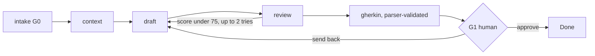
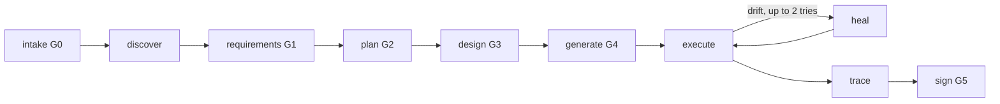

# Agentic QE Platform system design

## Goal

Agentic QE Platform gives BAs and developers one governed workspace. It turns briefs into templated requirements and Gherkin, scans real repositories, builds features and fixes on isolated branches, runs the full test lifecycle, and offers a project-aware chatbot. It brings the [agentic-qe](https://github.com/sarveshtalele/agentic-qe) plugin's lifecycle into a standalone web app built on Microsoft Agent Framework (MAF) in Python.

## Runtime

```mermaid
flowchart LR
  B[Browser] -->|pages| N[Next.js 16 UI]
  N -->|/api rewrite| A[FastAPI]
  B -->|CopilotKit| R[CopilotKit runtime route]
  R -->|AG-UI HttpAgent| G[/agui/agent]
  G --> M[MAF Agent]
  A --> E[Run engine]
  E --> W[MAF Workflows]
  W --> M
  W --> D[Deterministic checks]
  M --> L[OpenAI-compatible model]
  A --> S[(SQLite)]
  E --> C[(File checkpoints)]
  W --> F[(Project files, repo, worktrees)]
  D --> X[Git, ruff, test runners]
```

| Layer | Responsibility | Trust rule |
|---|---|---|
| UI | Projects page, inside-project views, editors, approval cards, chat | Holds no business rules |
| API | REST, uploads, SSE timelines, origin and host guard | Validates all input |
| Engine | Starts runs, stores events, pauses at approvals, resumes from checkpoints | A restart between pause and decision is safe |
| Workflows | Typed stages on MAF `WorkflowBuilder` | Code checks all model output |
| Agents | Prompted MAF agents with project-scoped tools | Read repo content as untrusted data |
| Governance | Gates, ledger, versions, prompt history, agent policy, guardrails, evals | Humans approve; agents cannot |

## Stored data

| Store | Contents |
|---|---|
| `data/atlas.sqlite3` | Projects, documents and versions, templates, prompts, runs and events, run failures, approvals, gates, ledger, findings, chats, memories, encrypted credentials, evals, agent settings, agent calls, guardrail events, users, models, user model ticks and limits, project members, sessions, auth events |
| `data/logs/app-YYYY-MM-DD.jsonl` | Daily application log: one line per request, warning, or error |
| `data/runs/<run>/parts/`, `data/runs/<run>/failures/` | Finished batches, and rejected model replies with secrets masked |
| `data/projects/<id>/repo` | Cloned or unpacked code |
| `data/projects/<id>/worktrees/<run>` | Isolated branch per change or QE run |
| `data/projects/<id>/documents/<kind>/<doc>/vNNNN.*` | Every document version as a readable file |
| `data/projects/<id>/sources` | Uploaded source files |
| `data/checkpoints/<run>` | MAF workflow checkpoints |

## Plugin to Agentic QE Platform mapping

### Commands and workflow stages

| Plugin command | Gate | Agentic QE Platform stage | Code | How it works in Agentic QE Platform |
|---|---|---|---|---|
| `qe-start` | G0 | `intake` in `ba` and `qe` | `maf/workflows/shared.py` `intake`, `intake_gate` | Detects mode from real files, then pauses for a signer. Skipped once G0 is approved |
| `qe-discover` | none | `discover` | `qe_discover`, `repos/scan.py`, `core/doc_checks.py` | `scan.analyze` builds facts from disk. The agent writes the summary. Code checks the required sections, that every cited path exists, and that every source folder is covered. A review follows, with one automatic revision |
| `qe-stories` | part of G1 | `ba` with Stories template; CSV and Jira export | `ba_draft`, `api/documents.py` export | Any template works. Test case tables export as 11-column CSV and Jira CSV |
| `qe-requirements` | G1 | `requirements` | `qe_requirements` | Each code-derived requirement carries file, line, and quote. `verify_quote` drops any that are not on disk |
| `qe-plan` | G2 | `plan` | `qe_plan`, `qe/model.py` `plan_confidence` | Deterministic score plus an independent reviewer. A low score triggers a revision |
| `qe-design` | G3 | `design` | `qe_design`, `coverage_gaps` | Enforces 1 Positive, 2 Negative, 1 Exception per P0 or P1 requirement, with no duplicates. Runs in batches of 4 requirements (`DESIGN_BATCH`), each reviewed |
| `qe-data` | part of G3 | `design` output and fixtures file | `qe_design`, `qe_generate` | Test data from cases is saved as a document and as `tests/agentic_qe/fixtures.json` |
| `qe-generate` | G4 | `generate` | `qe_generate` | One file per case, `CASE_ID` first line, no placeholders or tautologies, syntax-checked, on a separate branch. Runs in batches of 10 cases (`GENERATE_BATCH`) |
| `qe-execute` | none | `execute` | `qe_execute`, `qe/execution.py` | Registered runners only, no shell, scrubbed environment, JUnit parsing. Zero tests is `INCONCLUSIVE`. Greenfield records a RED baseline |
| `qe-heal` | none | `heal` | `qe_heal`, `classify_failure`, `assertions_preserved` | Heals drift only. Defects stay failing and are reported. Assertion changes are refused |
| `qe-trace` | none | `trace` | `qe_trace`, `qe/trace.py` | Requirement to case to test to result, with gaps and orphans |
| `qe-sign` | G5 | `sign` | `qe_sign` | Independent review from evidence, then a named human signs |
| `qe-panel` | none | QE Studio and run timeline | `app/projects/[id]/qe`, `RunPanel` | Live SSE timeline from stored events |
| `qe-doctor` | none | Settings health panel | `/api/health` | Checks git, Node, ruff, and model configuration |

### Agents

| Plugin agent | Agentic QE Platform prompt | Where it runs | Tools |
|---|---|---|---|
| `repo-intelligence-analyst` | `prompts/repo-intelligence-analyst.md` | QE discover, chat | Code in the message; read tools in chat |
| `requirements-analyst` | `prompts/requirements-analyst.md` | QE requirements, chat | Code in the message; read tools in chat |
| `principal-test-architect` | `prompts/principal-test-architect.md` | QE plan, chat | Text in the message; read tools in chat |
| `test-design-architect` | `prompts/test-design-architect.md` | QE design, chat | Text in the message; read tools in chat |
| `test-automation-engineer` | `prompts/test-automation-engineer.md` | QE generate | Code in the message |
| `qa-execution-engineer` | No model; `qe/execution.py` | QE execute, change verify | Deterministic by design |
| `defect-diagnostician` | `prompts/defect-diagnostician.md` | Heal, bug fix, diagnose, chat | Read and guarded write tools on the worktree |
| `confidence-reviewer` | `prompts/confidence-reviewer.md` | Plan and release review | Works from supplied evidence |
| Agentic QE Platform addition | `business-analyst` (also writes Gherkin), `bug-reviewer`, `feature-engineer`, `project-copilot` | BA, bug scan, change, chat | As listed in `maf-guide.md` |

### Hooks and guardrails

| Plugin hook | Agentic QE Platform equivalent | Enforced in |
|---|---|---|
| `guard-write` | Path confinement, protected directories, secret scan on every agent edit | `core/security.py`, `apply_edits` |
| `guard-bash` | Agents have no shell tool. Subprocesses use fixed argument lists | `repos/git.py`, `qe/execution.py` |
| `approval-hook`, `on-decision` | Approval cards, gate order, named signer, HMAC signature | `maf/engine.py`, `core/gates.py` |
| `ledger-hook`, `memory-logger` | Hash-chained ledger with tamper detection | `core/ledger.py` |
| `stamp-metadata` | Version, hash, author, and prompt reference on each document | `core/documents.py` |
| `session-check` | Startup recovery of interrupted runs, health endpoint | `engine.recover`, `/api/health` |

### Capability scripts

| Plugin script | Python port |
|---|---|
| `scan-repo.ts` | `repos/scan.py` `analyze` |
| `extract-contracts.ts` | `static_analysis.verify_quote`, `qe/model.py` `Requirement` |
| `calculate-risk.ts` | `qe/model.py` `plan_confidence` |
| `generate-cases.ts` | `qe/model.py` `TestCase`, `coverage_gaps` |
| `export-cases.ts` | `api/documents.py` CSV and Jira export |
| `emit-tests.ts` | `prompts/test-automation-engineer.md` with checks in `qe_generate` |
| `synthesize-data.ts` | Test data in the design stage, written as fixtures |
| `parse-junit.ts`, `run-isolated.ts` | `qe/execution.py` `parse_junit`, `verdict` |
| `diagnose-failure.ts`, `apply-healing.ts` | `classify_failure`, `assertions_preserved` |
| `build-matrix.ts` | `qe/trace.py` `build_matrix` |
| `build-dashboard.ts`, reports | Release and traceability documents with MD and DOCX export |

## Workflows in detail

### BA (`ba`)



The draft must keep every template heading, or it is sent back naming the missing ones. Each draft and edit is a new version.

### QE (`qe`)



Sending back at any gate reruns that stage with the feedback.

### Bug scan (`bug_scan`)

`prepare` fans out to `static` (ruff, secrets, JS rules, manifests) and `agent_review` (the riskiest files), then fans in to `merge`. Agent claims survive only if the quote exists in the file. Findings are de-duplicated across scans.

### Change (`change`)

`prepare` creates a worktree and branch. `implement` sends the selected code in the message to the feature engineer or diagnostician, which reply with structured edits. Agentic QE Platform applies them through path, secret, and scope guards, and sends refusals and current files back for another round. Existing assertions a change alters are shown to the reviewer. A fix for a finding must change that finding's file. `verify` runs the real tests, with up to 3 attempts on failure, while a confidence review runs beside them. When the tests fail, `cap_for_failed_tests` caps that review's score at 60. The diff waits for a human. On approval Agentic QE Platform commits to the branch and can push, open a pull request, and merge on a further click. The main checkout is never edited.

## Private repositories

A GitHub fine-grained token is validated against GitHub, encrypted at rest, and used to list repositories. It reaches git through an environment-scoped `http.extraHeader`, so it never appears in argv, URLs, or `.git/config`. Any HTTPS Git host works for public clones. A local folder or ZIP covers the case with no host.

## Chatbot

CopilotKit's headless hooks in the browser call a Next.js runtime route, which reaches `/agui/{agent}` over AG-UI. The server finds the project from the thread row, so a client cannot reach another project through a thread id. Threads and messages are stored in SQLite. Project memory is injected by a MAF context provider. Tools read documents and code, report status, remember facts, and start workflows. Gates still need a human on the app pages. The chat also opens in its own window at `/chat/{project}`.

## Access, models, errors, and logs

Where each rule lives. Every row names the code that enforces it.

| Feature | Code | Stored in |
|---|---|---|
| Roles, project members, ownership transfer | `core/auth.py` `access_problem`, `project_role`, `can_write`, `transfer_project` | `users.role`, `project_members`, `projects.owner_id` |
| Gate signing by role | `core/auth.py` `gate_signing_problem`, `set_gate_roles`; `engine.decide` | `settings` (`gate_roles`) |
| Allowed models, default, and the model list | `core/models.py` `allowed`, `check_allowed`, `set_allowed`; `api/settings.py` (`load_models` uses `maf/llm.py` `proxy_models`) | `models`, `user_models`, `users.model` |
| Which model a call uses | `core/auth.py` `model_for`, `permit_model` | `runs.model`, `agent_settings.model`, `agent_calls.model` |
| Daily, weekly, monthly, and per-model limits | `core/models.py` `bounds`, `limit_problem`, `usage_rows`; `core/auth.py` `check_allowance` | `user_limits`, `agent_calls`, `settings` (`timezone`) |
| Typed errors | `core/errors.py` (`AqeError` and subclasses), `classify` | Raised in code |
| Failure records and saved replies | `maf/engine.py` `record_failure` | `run_failures`, `data/runs/<run>/failures/` |
| Retry and partial results | `maf/engine.py` `retry`; `maf/workflows/qe.py` `PARTIAL_AFTER`, `settle` | `runs`, `data/runs/<run>/parts/` |
| One active run per kind | `maf/engine.py` `start`, `retry`, `RunActive` (409) | `runs` |
| Daily application log and retention | `core/logs.py` `DailyJsonHandler`, `prune`; `api/logs.py` | `data/logs/app-YYYY-MM-DD.jsonl` |
| Proxy cache control | `config.MODEL_NO_CACHE`, `maf/runtime.py` `build` | Environment (`ATLAS_MODEL_NO_CACHE`) |

## Agent governance

`src/backend/maf/governance.py` holds the registry of 12 agents: risk tier, tools, token limit. The Agents page shows policy, eval scores, calls, tokens, latency, errors, and guardrail events from stored data, and lets a named person disable an agent. Text from briefs, sources, and repositories passes secret and injection filters before the model sees it. Model providers can reject such text, which would otherwise fail a whole run.

## Limits

- Users are separated by account and project ownership, but repository code runs on the same machine. See `docs/AZURE_SYSTEM_DESIGN.md` before admitting untrusted users.
- Target test code runs with host permissions, in a scrubbed environment, after G4 approval. There is no OS sandbox.
- Keyword document search has no embeddings.
- JavaScript static rules are line patterns; JS depth comes from agent review.
- CI status for the current commit is not yet confirmed. The last confirmed run was green on Windows, macOS, and Linux at commit 34f6dda. CI runs the offline tests only. The end-to-end suite needs the real model, so it runs by hand.
- Injection detection uses patterns, so it reduces risk and does not eliminate it. Worktree isolation, human gates, and path guards are the real boundary.
- A secret split across two streamed chat chunks can appear in the live stream. The final snapshot and stored copy are clean.
