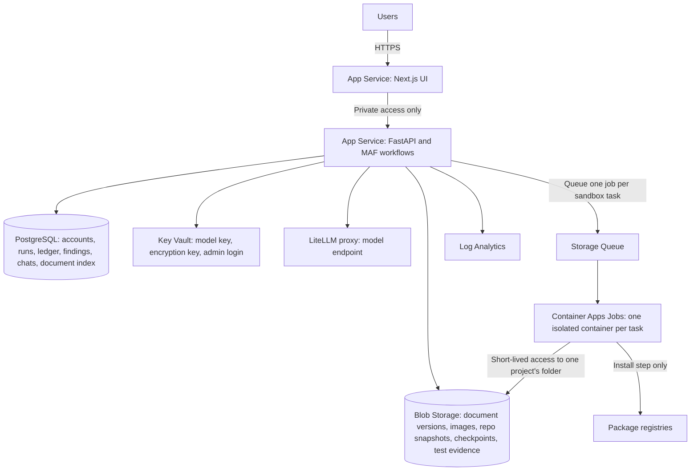

# Azure system design, East US 2

This is the target design for running Agentic QE Platform for several users on Azure, in East US 2, next to the current model endpoint.

**Status: this is a design, and it is not built yet.** Azure has never been deployed for real, even in the simple form. Today the app runs as one process with SQLite and local folders, which `docs/AZURE_DEPLOY.md` deploys as it stands. That version suits one person or a small trusted team. The changes needed to reach this design are listed under [Migration steps](#migration-steps).

Prices come from the [Azure Retail Prices API](https://learn.microsoft.com/en-us/rest/api/cost-management/retail-prices/azure-retail-prices) in INR for `eastus2`, fetched on 1 November 2026. They exclude taxes. A month is 730 hours.

## The design at a glance

## Where each thing is stored

The rule: **PostgreSQL holds small records you search and join. Blob Storage holds files. Key Vault holds secrets.** Azure SQL is not needed as well.

| Data | Store | Why |
|---|---|---|
| Users, sessions, sign-in events (tables `users`, `sessions`, `auth_events` in SQLite today) | PostgreSQL | Looked up on every request, and need transactions |
| Projects, runs, run events, approvals, gates | PostgreSQL | Joined and filtered constantly |
| Audit ledger | PostgreSQL | Each entry must commit in strict order with its hash |
| Findings, chats, memories, agent calls, tool calls, guardrail events | PostgreSQL | Powers Observability and Agents, which need filtering and totals |
| Document index: title, version, SHA-256, author, status | PostgreSQL | Lists and history |
| Document content for each version | Blob, path `projects/{id}/documents/{doc}/v{n}` | Immutable text, and large documents would bloat the database |
| Document images and exports | Blob | Binary files |
| Repository snapshot | Blob, as one Git bundle per project | One file holds full history and is fast to fetch. Thousands of small files on network storage are slow |
| Workflow checkpoints | Blob | Written often and read only on resume |
| Test results and sandbox logs | Blob, with a summary in PostgreSQL | Evidence stays complete while lists stay fast |
| Model key, encryption key, admin login, GitHub tokens | Key Vault | Access can be audited and keys rotated without redeploying |
| Application logs | Log Analytics | Search and alerts, and the first 5 GB a month is free |

Turn on **blob versioning** and an **immutability policy** for the document and evidence containers, so storage backs up the promise that versions cannot change.

## Why PostgreSQL over Azure SQL

| Option | Lowest suitable price | Fit |
|---|---|---|
| **PostgreSQL Flexible Server, B1MS (choice)** | ₹1,181.80 a month, plus ₹10.95 per GB | Fixed price, close to SQLite's SQL, and open source |
| Azure SQL serverless, 1 vCore | ₹49.69 per active hour | Cheap only when idle. Long agent runs keep it awake, so a busy month costs far more |
| SQLite on `/home` | Included | Works for one instance only, and is slow on network storage |

Azure SQL also has a free serverless offer with monthly limits. Check its current limits if you want to pilot at no database cost, but plan on PostgreSQL.

## Monthly cost

Assumes 5 users, 50 GB of files, and 300 sandbox tasks a month, each 10 minutes on 1 vCPU and 2 GiB.

| Component | Basis | ₹ per month |
|---|---|---|
| App Service, one B1 Linux plan holding UI and API | ₹1.6189 per hour | 1,181.80 |
| PostgreSQL B1MS | ₹1.6189 per hour | 1,181.80 |
| PostgreSQL storage | 32 GB at ₹10.9513 | 350.44 |
| Blob storage | 50 GB Hot LRS at ₹1.7522 | 87.61 |
| Blob operations | 100,000 writes at ₹4.7614 and 500,000 reads at ₹0.3809, per 10,000 | 66.66 |
| Storage Queue | 100,000 operations at ₹0.3809 per 10,000 | 3.81 |
| Container Apps Jobs, CPU | 180,000 vCPU seconds at ₹0.0023 | 414.00 |
| Container Apps Jobs, memory | 360,000 GiB seconds at ₹0.0003 | 108.00 |
| Container Registry Basic | ₹15.8651 per day | 482.62 |
| Key Vault | 100,000 operations at ₹2.8569 per 10,000 | 28.57 |
| Log Analytics | First 5 GB free | 0 |
| Outbound data | First 100 GB free | 0 |
| **Total** | | **about ₹3,905** |

Your model provider bills separately. Container Apps also has a monthly free grant that may cover the sandbox lines, so check its current size. When one B1 gets busy, P1 v3 is ₹14.7605 an hour, about ₹10,775 a month.

## Sandboxes for many users

### Why today's sandbox is not enough

Today, test code runs as a subprocess on the same machine and account as the app. It cannot see platform secrets in its environment, but **it could read other projects' files and the database on disk**. Users' test runs also compete for one CPU. That is acceptable for one person, and not for several.

### The design

**The rule: repository code never runs where the app runs.**

| Step | What happens |
|---|---|
| 1. Request | A workflow reaches a step that runs repository code, and the API adds a job to the queue with the run id |
| 2. Start | Container Apps starts one new container for that job. It scales to zero when idle, so idle time is free |
| 3. Fetch | The container receives a short-lived link (SAS) to only that project's folder, and restores the Git bundle |
| 4. Install | Dependencies install with internet access limited to package registries, using a cache keyed by the lockfile's hash |
| 5. Run tests | Tests run with **no network**, as a non-root user, with limits on CPU, memory, and time |
| 6. Report | JUnit results and logs go to Blob, a queue message reports completion, and the container is destroyed |
| 7. Continue | The API reads the results and the workflow carries on |

### What this protects

| Risk | Control |
|---|---|
| One user reads another's code | Each task has its own container and a link to one project only |
| Test code steals the model key | The key never enters a sandbox. Agents run in the API, and only tests run in sandboxes |
| Test code sends data out | No network during tests |
| A malicious install script | Registries only during install, a throwaway container, and no secrets present |
| One user starves the others | A per-user limit on running jobs, then a queue. Each job has CPU, memory, and time limits |
| Leftover files | The container is destroyed after each task, and old blobs expire by lifecycle rule |

### Your proxy key

You are right that one LiteLLM key makes this simpler, since sandboxes never need it. Keep it only in Key Vault, for the API. Then give **each user a LiteLLM virtual key with its own budget and allowed models**. The app already enforces allocations, so the proxy becomes a second, independent limit, and its spend report is a check on the app's numbers.

### Which Azure service runs the sandbox

| Option | Isolation | Cost when idle | Choice |
|---|---|---|---|
| App Service subprocess (today) | None between users | Part of the plan | Single user only |
| **Container Apps Jobs** | Separate container per task, sharing the environment's infrastructure | Free | **Start here, for known company users** |
| Container Apps dynamic sessions, custom container | Hyper-V boundary per session, with optional network controls | Pool charges apply | **Move here if outsiders' code will run.** Check it allows long test runs in a pilot |
| Container Instances | Separate group per task | Free | Workable, but with fewer scaling and job controls |
| AKS | Strong, with extra work | Cluster always costs | Too much to operate at this size |

Azure lists dynamic sessions at ₹2.8569 per session hour in East US 2. Check how custom container pools are billed before you commit, since they may differ.

## Running several API instances

The current engine runs each workflow inside one process. To add instances later, keep one until these are done:

| Change | Why |
|---|---|
| Add a lease to each run in PostgreSQL | Only one instance works on a run, and another can take over after a crash |
| Serve run logs from the database | Already how the live log works, so any instance can serve it |
| Move login lockouts to PostgreSQL | Lockouts are per process today |
| Keep checkpoints in Blob | So any instance can resume a run |

## Migration steps

Each step works on its own, so you can stop after any of them.

| Step | Work | Result |
|---|---|---|
| 1. Deploy as it is | `docs/AZURE_DEPLOY.md` | One trusted team on one plan |
| 2. Key Vault | Read settings from Key Vault references | No secrets in app settings |
| 3. PostgreSQL | Replace `db.py` connections and adjust SQL and migrations | Reliable data and backups |
| 4. Blob Storage | Add a storage layer for documents, images, checkpoints, and evidence | Files are safe and survive redeploys |
| 5. Sandbox jobs | Build a runner image, queue, and job, and call it from `qe/execution.py` | **Safe for several users.** This is the key step |
| 6. Per-user proxy keys | Create LiteLLM virtual keys when users are created | A second budget limit |
| 7. Several instances | Run leases and shared lockouts | High availability |

**Do step 5 before letting people outside a trusted team use it.** Until then, leave **Install repository dependencies** off for repositories you do not trust.
