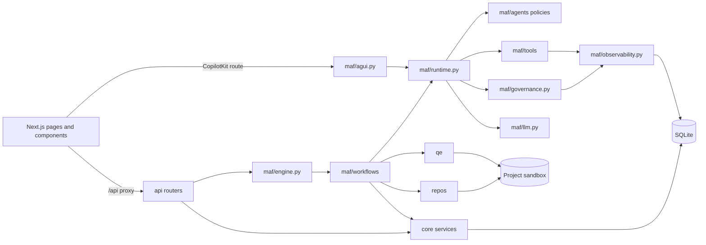

# Project structure

Generated by `python scripts/gen_structure.py`, so links come from the real imports. Run it again after adding files.

In this table, `ui/` means `src/frontend/`, and backend paths start from `src/backend/`.

## How the parts connect

The project has 219 files, not counting screenshots.

## Backend application

| File | What it does | Uses | Used by |
|---|---|---|---|
| `src/backend/app.py` | FastAPI application: REST API for the UI, AG-UI for the chatbot, background MAF workflows. | `__init__.py`, `api/__init__.py`, `config.py`, `core/auth.py`, `core/documents.py`, `core/errors.py`, `core/files.py`, `core/gates.py`, and 14 more | `tests/test_access.py`, `tests/test_api_workflows.py`, `tests/test_errors.py`, `tests/test_ops.py` |
| `src/backend/config.py` | Paths and environment. ATLAS_DATA_DIR lets tests run against a throwaway store. |  | `api/common.py`, `api/logs.py`, `api/projects.py`, `api/repository.py`, `api/templates.py`, `app.py`, `core/documents.py`, `core/files.py`, and 22 more |
| `src/backend/db.py` | SQLite access: one short connection per unit of work, numbered SQL migrations via user_version. | `config.py` | `api/chat.py`, `api/common.py`, `api/documents.py`, `api/findings.py`, `api/governance.py`, `api/observability.py`, `api/projects.py`, `api/runs.py`, and 32 more |

## REST API

| File | What it does | Uses | Used by |
|---|---|---|---|
| `src/backend/api/__init__.py` | REST API, one router per area. | `api/auth.py`, `api/chat.py`, `api/documents.py`, `api/findings.py`, `api/governance.py`, `api/logs.py`, `api/observability.py`, `api/projects.py`, and 4 more | `app.py` |
| `src/backend/api/auth.py` | Sign-in and user management. | `core/auth.py` | `api/__init__.py` |
| `src/backend/api/chat.py` | Chat API. | `api/common.py`, `core/auth.py`, `db.py`, `maf/agui.py`, `maf/engine.py`, `maf/evals.py`, `maf/governance.py`, `maf/llm.py`, and 2 more | `api/__init__.py` |
| `src/backend/api/common.py` | Helpers shared by routers. | `__init__.py`, `config.py`, `db.py` | `api/chat.py`, `api/documents.py`, `api/governance.py`, `api/projects.py`, `api/repository.py`, `api/runs.py`, `api/templates.py` |
| `src/backend/api/documents.py` | Documents API. | `api/common.py`, `core/auth.py`, `core/doc_checks.py`, `core/documents.py`, `core/files.py`, `core/security.py`, `db.py`, `maf/agui.py`, and 6 more | `api/__init__.py` |
| `src/backend/api/findings.py` | Findings API. | `core/auth.py`, `core/ledger.py`, `db.py`, `maf/agui.py`, `maf/engine.py`, `maf/evals.py`, `maf/governance.py`, `maf/llm.py`, and 1 more | `api/__init__.py` |
| `src/backend/api/governance.py` | Governance API. | `api/common.py`, `core/auth.py`, `core/gates.py`, `core/ledger.py`, `core/prompts.py`, `db.py`, `maf/agui.py`, `maf/engine.py`, and 4 more | `api/__init__.py` |
| `src/backend/api/logs.py` | Admin download of one day's application log. | `config.py`, `core/logs.py`, `core/security.py` | `api/__init__.py` |
| `src/backend/api/observability.py` | Observability API: the log of agents, skills, tools, workflows, approvals, guardrails, and the ledger. | `core/auth.py`, `db.py`, `maf/observability.py` | `api/__init__.py` |
| `src/backend/api/projects.py` | Projects API. | `api/common.py`, `config.py`, `core/auth.py`, `core/documents.py`, `core/gates.py`, `core/ledger.py`, `core/security.py`, `db.py`, and 7 more | `api/__init__.py` |
| `src/backend/api/repository.py` | Repository API. | `api/common.py`, `config.py`, `core/auth.py`, `core/security.py`, `maf/agui.py`, `maf/engine.py`, `maf/evals.py`, `maf/governance.py`, and 5 more | `api/__init__.py` |
| `src/backend/api/runs.py` | Workflows API. | `api/common.py`, `core/auth.py`, `core/ledger.py`, `core/security.py`, `db.py`, `maf/agui.py`, `maf/engine.py`, `maf/evals.py`, and 6 more | `api/__init__.py` |
| `src/backend/api/settings.py` | Connections and settings API. | `core/auth.py`, `core/models.py`, `maf/agui.py`, `maf/engine.py`, `maf/evals.py`, `maf/governance.py`, `maf/llm.py`, `maf/workflows/__init__.py`, and 1 more | `api/__init__.py` |
| `src/backend/api/templates.py` | Templates and source documents API. | `api/common.py`, `config.py`, `core/files.py`, `core/security.py`, `db.py`, `maf/agui.py`, `maf/engine.py`, `maf/evals.py`, and 3 more | `api/__init__.py` |

## Agents

| File | What it does | Uses | Used by |
|---|---|---|---|
| `src/backend/maf/agents/__init__.py` | Agent registry. Each file in this folder declares one agent's POLICY, so adding an agent means adding a file. | `maf/agents/policy.py` | `maf/governance.py`, `tests/test_core.py`, `tests/test_migration_006.py` |
| `src/backend/maf/agents/bug_reviewer.py` | Finds defects in code it is given. Prompt: prompts/bug-reviewer.md. Evals: evals/bug-reviewer.json. | `maf/agents/policy.py` |  |
| `src/backend/maf/agents/business_analyst.py` | Writes requirements documents from a brief and sources, and converts them to validated Gherkin. Prompt: prompts/business-analyst.md. Evals: evals/business-analyst.json. | `maf/agents/policy.py` |  |
| `src/backend/maf/agents/confidence_reviewer.py` | Scores requirements documents, plans, and releases from evidence. Prompt: prompts/confidence-reviewer.md. Evals: evals/confidence-reviewer.json. | `maf/agents/policy.py` |  |
| `src/backend/maf/agents/defect_diagnostician.py` | Fixes defects and test drift on a branch. Prompt: prompts/defect-diagnostician.md. Evals: evals/defect-diagnostician.json. | `maf/agents/policy.py` |  |
| `src/backend/maf/agents/feature_engineer.py` | Implements features on a branch. Prompt: prompts/feature-engineer.md. Evals: evals/feature-engineer.json. | `maf/agents/policy.py` |  |
| `src/backend/maf/agents/policy.py` | What an agent is allowed to do. Each agent file declares one POLICY. |  | `maf/agents/__init__.py`, `maf/agents/bug_reviewer.py`, `maf/agents/business_analyst.py`, `maf/agents/confidence_reviewer.py`, `maf/agents/defect_diagnostician.py`, `maf/agents/feature_engineer.py`, `maf/agents/principal_test_architect.py`, `maf/agents/project_copilot.py`, and 4 more |
| `src/backend/maf/agents/principal_test_architect.py` | Plans tests by risk and level. Prompt: prompts/principal-test-architect.md. Evals: evals/principal-test-architect.json. | `maf/agents/policy.py` |  |
| `src/backend/maf/agents/project_copilot.py` | Answers from project data and starts workflows on request. Prompt: prompts/project-copilot.md. Evals: evals/project-copilot.json. | `maf/agents/policy.py` |  |
| `src/backend/maf/agents/repo_intelligence_analyst.py` | Summarizes a repository from scan facts and code. Prompt: prompts/repo-intelligence-analyst.md. Evals: evals/repo-intelligence-analyst.json. | `maf/agents/policy.py` |  |
| `src/backend/maf/agents/requirements_analyst.py` | Derives testable requirements with quoted evidence. Prompt: prompts/requirements-analyst.md. Evals: evals/requirements-analyst.json. | `maf/agents/policy.py` |  |
| `src/backend/maf/agents/test_automation_engineer.py` | Generates executable tests for approved cases. Prompt: prompts/test-automation-engineer.md. Evals: evals/test-automation-engineer.json. | `maf/agents/policy.py` |  |
| `src/backend/maf/agents/test_design_architect.py` | Designs test cases with oracles. Prompt: prompts/test-design-architect.md. Evals: evals/test-design-architect.json. | `maf/agents/policy.py` |  |

## Tools

| File | What it does | Uses | Used by |
|---|---|---|---|
| `src/backend/maf/tools/__init__.py` | MAF function tools, one file each. Every set closes over a project, so an agent can only reach that project's data. | `config.py`, `maf/tools/grep.py`, `maf/tools/list_documents.py`, `maf/tools/list_files.py`, `maf/tools/list_findings.py`, `maf/tools/project_status.py`, `maf/tools/read_document.py`, `maf/tools/read_file.py`, and 5 more | `maf/agui.py`, `maf/runtime.py`, `tests/test_core.py` |
| `src/backend/maf/tools/common.py` | Helpers shared by tools. | `core/documents.py` | `maf/tools/read_document.py`, `maf/tools/save_document.py` |
| `src/backend/maf/tools/grep.py` | The grep agent tool. | `core/security.py`, `repos/scan.py` | `maf/tools/__init__.py` |
| `src/backend/maf/tools/list_documents.py` | The list_documents agent tool. | `core/documents.py` | `maf/tools/__init__.py` |
| `src/backend/maf/tools/list_files.py` | The list_files agent tool. | `repos/scan.py` | `maf/tools/__init__.py` |
| `src/backend/maf/tools/list_findings.py` | The list_findings agent tool. | `db.py` | `maf/tools/__init__.py` |
| `src/backend/maf/tools/project_status.py` | The project_status agent tool. | `core/gates.py`, `db.py` | `maf/tools/__init__.py` |
| `src/backend/maf/tools/read_document.py` | The read_document agent tool. | `core/documents.py`, `maf/tools/common.py` | `maf/tools/__init__.py` |
| `src/backend/maf/tools/read_file.py` | The read_file agent tool. | `core/security.py` | `maf/tools/__init__.py` |
| `src/backend/maf/tools/remember.py` | The remember agent tool. | `maf/runtime.py` | `maf/tools/__init__.py` |
| `src/backend/maf/tools/save_document.py` | The save_document agent tool. | `core/documents.py`, `maf/tools/common.py` | `maf/tools/__init__.py` |
| `src/backend/maf/tools/search_documents.py` | The search_documents agent tool. | `core/documents.py` | `maf/tools/__init__.py` |
| `src/backend/maf/tools/start_workflow.py` | The start_workflow agent tool. |  | `maf/tools/__init__.py` |
| `src/backend/maf/tools/verify_ledger.py` | The verify_ledger agent tool. | `core/ledger.py` | `maf/tools/__init__.py` |

## Workflows

| File | What it does | Uses | Used by |
|---|---|---|---|
| `src/backend/maf/workflows/__init__.py` | Workflows, one file each. A file registers its definition in engine.REGISTRY, so adding a workflow means adding a file. | `maf/workflows/ba.py`, `maf/workflows/bug_scan.py`, `maf/workflows/edits.py`, `maf/workflows/qe.py` | `api/chat.py`, `api/documents.py`, `api/findings.py`, `api/governance.py`, `api/projects.py`, `api/repository.py`, `api/runs.py`, `api/settings.py`, and 6 more |
| `src/backend/maf/workflows/ba.py` | BA workflow: brief to templated document, independent review, Gherkin, human approval. | `core/doc_checks.py`, `core/documents.py`, `core/files.py`, `core/gherkin.py`, `db.py`, `maf/engine.py`, `maf/runtime.py`, `maf/workflows/shared.py` | `maf/workflows/__init__.py`, `maf/workflows/qe.py` |
| `src/backend/maf/workflows/bug_scan.py` | Bug scan workflow: fan-out static and agent review, fan-in with evidence checks. | `config.py`, `core/errors.py`, `core/security.py`, `db.py`, `maf/engine.py`, `maf/runtime.py`, `maf/workflows/shared.py`, `repos/git.py`, and 3 more | `maf/workflows/__init__.py`, `tests/test_core.py` |
| `src/backend/maf/workflows/change.py` | Change workflow: feature, bug fix, or traceback diagnosis on an isolated branch with real tests. | `config.py`, `core/documents.py`, `core/errors.py`, `core/security.py`, `db.py`, `maf/engine.py`, `maf/runtime.py`, `maf/workflows/edits.py`, and 7 more | `tests/test_api_workflows.py`, `tests/test_core.py` |
| `src/backend/maf/workflows/edits.py` | Structured edits from agents, applied by code through path, secret, and scope guards. | `core/security.py`, `qe/execution.py` | `maf/workflows/__init__.py`, `maf/workflows/change.py`, `maf/workflows/qe.py` |
| `src/backend/maf/workflows/qe.py` | QE lifecycle: requirements to signed release, with human gates G0 to G5. | `config.py`, `core/doc_checks.py`, `core/documents.py`, `core/errors.py`, `core/security.py`, `maf/engine.py`, `maf/runtime.py`, `maf/workflows/ba.py`, and 8 more | `maf/workflows/__init__.py`, `tests/test_errors.py` |
| `src/backend/maf/workflows/shared.py` | Helpers every workflow uses: repository facts, the code pack, and the Gate 0 intake. | `config.py`, `core/errors.py`, `core/gates.py`, `core/security.py`, `maf/engine.py`, `maf/runtime.py`, `qe/model.py`, `repos/ingest.py`, and 2 more | `maf/workflows/ba.py`, `maf/workflows/bug_scan.py`, `maf/workflows/change.py`, `maf/workflows/qe.py` |

## Agent runtime and governance

| File | What it does | Uses | Used by |
|---|---|---|---|
| `src/backend/maf/agui.py` | AG-UI endpoint for the chatbot. MAF's AgentFrameworkAgent produces the protocol stream. | `core/auth.py`, `core/errors.py`, `core/ledger.py`, `core/security.py`, `db.py`, `maf/engine.py`, `maf/governance.py`, `maf/llm.py`, and 2 more | `api/chat.py`, `api/documents.py`, `api/findings.py`, `api/governance.py`, `api/projects.py`, `api/repository.py`, `api/runs.py`, `api/settings.py`, and 2 more |
| `src/backend/maf/engine.py` | Run manager over real MAF workflows: typed stages, HITL via request_info, file checkpoints, durable events. | `config.py`, `core/auth.py`, `core/errors.py`, `core/gates.py`, `core/ledger.py`, `core/security.py`, `db.py`, `maf/runtime.py` | `api/chat.py`, `api/documents.py`, `api/findings.py`, `api/governance.py`, `api/projects.py`, `api/repository.py`, `api/runs.py`, `api/settings.py`, and 11 more |
| `src/backend/maf/evals.py` | Agent evals on MAF's evaluation API. Each case runs the real active prompt, so prompt versions can be compared. | `config.py`, `core/errors.py`, `core/gherkin.py`, `core/prompts.py`, `db.py`, `maf/runtime.py`, `maf/workflows/__init__.py`, `qe/model.py` | `api/chat.py`, `api/documents.py`, `api/findings.py`, `api/governance.py`, `api/projects.py`, `api/repository.py`, `api/runs.py`, `api/settings.py`, and 4 more |
| `src/backend/maf/governance.py` | Agent governance: one registry, per-agent tool policy, an admin kill switch, guardrails, and call telemetry. | `core/auth.py`, `core/errors.py`, `core/ledger.py`, `core/models.py`, `core/prompts.py`, `core/security.py`, `db.py`, `maf/agents/__init__.py`, and 1 more | `api/chat.py`, `api/documents.py`, `api/findings.py`, `api/governance.py`, `api/projects.py`, `api/repository.py`, `api/runs.py`, `api/settings.py`, and 6 more |
| `src/backend/maf/llm.py` | Model provider settings. Environment wins on first run; the Settings page can override and encrypts the key. | `config.py`, `core/errors.py`, `core/security.py`, `db.py` | `api/chat.py`, `api/documents.py`, `api/findings.py`, `api/governance.py`, `api/projects.py`, `api/repository.py`, `api/runs.py`, `api/settings.py`, and 10 more |
| `src/backend/maf/observability.py` | One log of everything agents and workflows did, for a run, a project, or all projects. Reads stored records only. | `core/auth.py`, `core/ledger.py`, `core/security.py`, `db.py` | `api/observability.py`, `maf/governance.py`, `maf/runtime.py`, `tests/test_access.py`, `tests/test_api_workflows.py` |
| `src/backend/maf/runtime.py` | Agent construction on the real Microsoft Agent Framework, with middleware and JSON validation. | `config.py`, `core/auth.py`, `core/documents.py`, `core/errors.py`, `core/ledger.py`, `core/prompts.py`, `core/security.py`, `db.py`, and 5 more | `api/chat.py`, `api/documents.py`, `maf/agui.py`, `maf/engine.py`, `maf/evals.py`, `maf/tools/remember.py`, `maf/workflows/ba.py`, `maf/workflows/bug_scan.py`, and 7 more |

## Core services

| File | What it does | Uses | Used by |
|---|---|---|---|
| `src/backend/core/auth.py` | Accounts and access. The admin login comes from .env. Users are created by the admin. | `core/errors.py`, `core/ledger.py`, `core/models.py`, `core/security.py`, `db.py`, `maf/llm.py` | `api/auth.py`, `api/chat.py`, `api/documents.py`, `api/findings.py`, `api/governance.py`, `api/observability.py`, `api/projects.py`, `api/repository.py`, and 12 more |
| `src/backend/core/doc_checks.py` | Deterministic requirements checks. They cap the reviewer's score, so a model cannot pass a weak document. | `core/files.py` | `api/documents.py`, `maf/workflows/ba.py`, `maf/workflows/qe.py`, `tests/test_api_workflows.py`, `tests/test_core.py` |
| `src/backend/core/documents.py` | Versioned documents. Every save is an immutable version with SHA-256, author, and prompt reference. | `config.py`, `core/gherkin.py`, `core/ledger.py`, `core/security.py`, `db.py`, `qe/model.py` | `api/documents.py`, `api/projects.py`, `app.py`, `maf/runtime.py`, `maf/tools/common.py`, `maf/tools/list_documents.py`, `maf/tools/read_document.py`, `maf/tools/save_document.py`, and 6 more |
| `src/backend/core/errors.py` | Typed errors. Each says what happened, what to do next, and whether a plain retry may help. | `core/security.py` | `app.py`, `core/auth.py`, `core/models.py`, `maf/agui.py`, `maf/engine.py`, `maf/evals.py`, `maf/governance.py`, `maf/llm.py`, and 9 more |
| `src/backend/core/files.py` | Uploaded-file text extraction, templates, and DOCX export. | `config.py`, `core/security.py`, `db.py` | `api/documents.py`, `api/templates.py`, `app.py`, `core/doc_checks.py`, `maf/workflows/ba.py`, `tests/conftest.py`, `tests/test_core.py` |
| `src/backend/core/gates.py` | Quality gates G0-G5. Sequential approval, HMAC-signed records, human signer required. | `core/ledger.py`, `core/security.py`, `db.py` | `api/governance.py`, `api/projects.py`, `app.py`, `maf/engine.py`, `maf/tools/project_status.py`, `maf/workflows/shared.py`, `tests/test_core.py` |
| `src/backend/core/gherkin.py` | Gherkin validation with the official Cucumber parser. |  | `core/documents.py`, `maf/evals.py`, `maf/workflows/ba.py`, `tests/test_core.py` |
| `src/backend/core/ledger.py` | Tamper-evident audit ledger: each entry hashes the previous entry, per project. | `core/security.py`, `db.py` | `api/findings.py`, `api/governance.py`, `api/projects.py`, `api/runs.py`, `core/auth.py`, `core/documents.py`, `core/gates.py`, `maf/agui.py`, and 8 more |
| `src/backend/core/logs.py` | Daily JSON-lines application log: data/logs/app-YYYY-MM-DD.jsonl. | `__init__.py`, `config.py`, `core/security.py` | `api/logs.py`, `app.py`, `tests/test_ops.py` |
| `src/backend/core/models.py` | The model list, who may use which model, and token limits per period. | `core/errors.py`, `db.py` | `api/settings.py`, `app.py`, `core/auth.py`, `maf/governance.py`, `tests/test_api_workflows.py`, `tests/test_models.py` |
| `src/backend/core/prompts.py` | Versioned agent prompts. prompts/*.md seed v1; every edit is a new immutable version in the DB. | `config.py`, `core/security.py`, `db.py` | `api/governance.py`, `app.py`, `maf/evals.py`, `maf/governance.py`, `maf/runtime.py`, `tests/conftest.py`, `tests/test_core.py`, `tests/test_migration_006.py` |
| `src/backend/core/security.py` | Secrets at rest, secret detection, redaction, path confinement, and shell-free command policy. | `config.py` | `api/documents.py`, `api/logs.py`, `api/projects.py`, `api/repository.py`, `api/runs.py`, `api/templates.py`, `app.py`, `core/auth.py`, and 26 more |

## Repositories

| File | What it does | Uses | Used by |
|---|---|---|---|
| `src/backend/repos/git.py` | Git via subprocess without a shell. Tokens travel in env-scoped config, never in argv, URLs, or .git/config. | `core/errors.py`, `core/security.py` | `api/runs.py`, `app.py`, `maf/workflows/bug_scan.py`, `maf/workflows/change.py`, `maf/workflows/qe.py`, `repos/ingest.py`, `repos/sandbox.py`, `tests/test_api_workflows.py`, and 2 more |
| `src/backend/repos/github.py` | GitHub REST calls for private-repo connection. A token validates, lists repos, and opens PRs. | `core/errors.py`, `core/security.py`, `db.py` | `api/runs.py`, `api/settings.py`, `app.py`, `maf/workflows/change.py`, `repos/ingest.py`, `repos/sandbox.py`, `tests/test_core.py` |
| `src/backend/repos/ingest.py` | Bring code into a project: clone a git URL (public or with a saved token) or unpack a ZIP safely. | `config.py`, `core/errors.py`, `core/ledger.py`, `db.py`, `repos/git.py`, `repos/github.py`, `repos/scan.py` | `api/projects.py`, `api/repository.py`, `api/runs.py`, `app.py`, `maf/runtime.py`, `maf/workflows/change.py`, `maf/workflows/shared.py`, `tests/test_core.py` |
| `src/backend/repos/sandbox.py` | Each project's sandbox: its own folder with a full clone, one worktree per run, its own Python environment. | `config.py`, `db.py`, `repos/git.py`, `repos/github.py` | `api/repository.py`, `maf/workflows/bug_scan.py` |
| `src/backend/repos/scan.py` | Evidence-only repository analysis: every field comes from files on disk. Port of plugin scan-repo.ts, extended. |  | `api/repository.py`, `maf/tools/grep.py`, `maf/tools/list_files.py`, `maf/workflows/bug_scan.py`, `maf/workflows/change.py`, `maf/workflows/qe.py`, `maf/workflows/shared.py`, `repos/ingest.py`, and 2 more |
| `src/backend/repos/static_analysis.py` | Deterministic scanners. A finding exists only with a file, a line, and the quoted line from disk. | `core/security.py`, `repos/scan.py` | `maf/workflows/bug_scan.py`, `maf/workflows/change.py`, `maf/workflows/qe.py`, `maf/workflows/shared.py`, `tests/test_core.py` |

## Quality engineering

| File | What it does | Uses | Used by |
|---|---|---|---|
| `src/backend/qe/execution.py` | Registered test runners, JUnit parsing, honest verdicts. No shell, bounded time, scrubbed environment. |  | `maf/workflows/change.py`, `maf/workflows/edits.py`, `maf/workflows/qe.py`, `tests/test_core.py`, `tests/test_errors.py` |
| `src/backend/qe/model.py` | Structured QE artifacts and the plugin's validators, ported from TypeScript to Python. |  | `core/documents.py`, `maf/evals.py`, `maf/workflows/qe.py`, `maf/workflows/shared.py`, `tests/test_core.py` |
| `src/backend/qe/trace.py` | Traceability matrix and release score, ported from build-matrix.ts and the plugin's verdict rules. |  | `maf/workflows/qe.py`, `tests/test_core.py` |

## Database migrations

| File | What it does | Uses | Used by |
|---|---|---|---|
| `src/backend/migrations/001_init.sql` | Database change: init |  |  |
| `src/backend/migrations/002_evaluations.sql` | Database change: evaluations |  |  |
| `src/backend/migrations/003_agent_governance.sql` | Database change: agent governance |  |  |
| `src/backend/migrations/004_tool_calls.sql` | Database change: tool calls |  |  |
| `src/backend/migrations/005_users.sql` | Database change: users |  |  |
| `src/backend/migrations/006_agent_plugin_names.sql` | Database change: agent plugin names |  |  |
| `src/backend/migrations/007_run_failures.sql` | Database change: run failures |  |  |
| `src/backend/migrations/008_observability_indexes.sql` | Database change: observability indexes |  |  |
| `src/backend/migrations/009_models_limits.sql` | Database change: models limits |  |  |
| `src/backend/migrations/010_roles_members.sql` | Database change: roles members |  |  |

## Agent prompts

| File | What it does | Uses | Used by |
|---|---|---|---|
| `prompts/bug-reviewer.md` | System prompt for the bug-reviewer agent |  |  |
| `prompts/business-analyst.md` | System prompt for the business-analyst agent |  |  |
| `prompts/confidence-reviewer.md` | System prompt for the confidence-reviewer agent |  |  |
| `prompts/defect-diagnostician.md` | System prompt for the defect-diagnostician agent |  |  |
| `prompts/feature-engineer.md` | System prompt for the feature-engineer agent |  |  |
| `prompts/principal-test-architect.md` | System prompt for the principal-test-architect agent |  |  |
| `prompts/project-copilot.md` | System prompt for the project-copilot agent |  |  |
| `prompts/repo-intelligence-analyst.md` | System prompt for the repo-intelligence-analyst agent |  |  |
| `prompts/requirements-analyst.md` | System prompt for the requirements-analyst agent |  |  |
| `prompts/test-automation-engineer.md` | System prompt for the test-automation-engineer agent |  |  |
| `prompts/test-design-architect.md` | System prompt for the test-design-architect agent |  |  |

## Agent evaluations

| File | What it does | Uses | Used by |
|---|---|---|---|
| `evals/bug-reviewer.json` | Quality and safety cases for the bug-reviewer agent |  |  |
| `evals/business-analyst.json` | Quality and safety cases for the business-analyst agent |  |  |
| `evals/confidence-reviewer.json` | Quality and safety cases for the confidence-reviewer agent |  |  |
| `evals/defect-diagnostician.json` | Quality and safety cases for the defect-diagnostician agent |  |  |
| `evals/feature-engineer.json` | Quality and safety cases for the feature-engineer agent |  |  |
| `evals/principal-test-architect.json` | Quality and safety cases for the principal-test-architect agent |  |  |
| `evals/project-copilot.json` | Quality and safety cases for the project-copilot agent |  |  |
| `evals/repo-intelligence-analyst.json` | Quality and safety cases for the repo-intelligence-analyst agent |  |  |
| `evals/requirements-analyst.json` | Quality and safety cases for the requirements-analyst agent |  |  |
| `evals/test-automation-engineer.json` | Quality and safety cases for the test-automation-engineer agent |  |  |
| `evals/test-design-architect.json` | Quality and safety cases for the test-design-architect agent |  |  |

## Document templates

| File | What it does | Uses | Used by |
|---|---|---|---|
| `templates/brd.md` | Built-in brd template |  |  |
| `templates/prd.md` | Built-in prd template |  |  |
| `templates/stories.md` | Built-in stories template |  |  |

## Frontend pages

| File | What it does | Uses | Used by |
|---|---|---|---|
| `src/frontend/app/account/page.tsx` | Page at `/account` | `ui/components/AppShell.tsx`, `ui/components/ui.tsx`, `ui/lib/api.ts` |  |
| `src/frontend/app/agents/[key]/page.tsx` | Page for one agent: details table, controls, evaluations | `ui/components/AppShell.tsx`, `ui/components/AuthGate.tsx`, `ui/components/ui.tsx`, `ui/lib/api.ts` |  |
| `src/frontend/app/agents/page.tsx` | Page at `/agents` | `ui/components/AppShell.tsx`, `ui/components/AuthGate.tsx`, `ui/components/ui.tsx`, `ui/lib/api.ts` |  |
| `src/frontend/app/api/copilotkit/[[...path]]/route.ts` | CopilotKit runtime, connecting chat to the AG-UI endpoint |  |  |
| `src/frontend/app/approvals/page.tsx` | Page at `/approvals` | `ui/components/AppShell.tsx`, `ui/components/ApprovalsList.tsx`, `ui/components/ui.tsx` |  |
| `src/frontend/app/chat/[id]/page.tsx` | Page at `/chat/{id}` | `ui/components/Chat.tsx` |  |
| `src/frontend/app/docs/[slug]/page.tsx` | Page at `/docs/{slug}` | `ui/components/ui.tsx`, `ui/content/docs.ts` |  |
| `src/frontend/app/docs/layout.tsx` | Documentation site frame: search and sidebar | `ui/components/ui.tsx`, `ui/content/docs.ts` |  |
| `src/frontend/app/docs/page.tsx` | Page at `/docs` |  |  |
| `src/frontend/app/documents/page.tsx` | Page at `/documents` | `ui/components/AppShell.tsx`, `ui/components/ui.tsx`, `ui/lib/api.ts` |  |
| `src/frontend/app/error.tsx` | Page error screen with its error id and a retry button | `ui/components/ui.tsx` |  |
| `src/frontend/app/findings/page.tsx` | Page at `/findings` | `ui/components/AppShell.tsx`, `ui/components/ui.tsx`, `ui/lib/api.ts` |  |
| `src/frontend/app/global-error.tsx` | Last-resort error screen for a failure in the root layout |  |  |
| `src/frontend/app/globals.css` | Design tokens and document styles |  | `ui/app/layout.tsx` |
| `src/frontend/app/layout.tsx` | Root HTML layout, theme, and toasts | `ui/app/globals.css`, `ui/components/AuthGate.tsx`, `ui/components/ui.tsx` |  |
| `src/frontend/app/login/page.tsx` | Page at `/login` | `ui/components/ui.tsx`, `ui/lib/api.ts` |  |
| `src/frontend/app/observability/page.tsx` | Page at `/observability` | `ui/components/AppShell.tsx`, `ui/components/Observability.tsx`, `ui/components/ui.tsx` |  |
| `src/frontend/app/page.tsx` | Page at `/` | `ui/components/AppShell.tsx`, `ui/components/ui.tsx`, `ui/lib/api.ts` |  |
| `src/frontend/app/projects/[id]/approvals/page.tsx` | Page at `/projects/{id}/approvals` | `ui/components/ApprovalsList.tsx`, `ui/components/ProjectShell.tsx`, `ui/components/ui.tsx` |  |
| `src/frontend/app/projects/[id]/ba/page.tsx` | Page at `/projects/{id}/ba` | `ui/components/ModelPicker.tsx`, `ui/components/ProjectShell.tsx`, `ui/components/RunPanel.tsx`, `ui/components/ui.tsx`, `ui/lib/api.ts` |  |
| `src/frontend/app/projects/[id]/bugs/page.tsx` | Page at `/projects/{id}/bugs` | `ui/components/ModelPicker.tsx`, `ui/components/ProjectShell.tsx`, `ui/components/RunPanel.tsx`, `ui/components/ui.tsx`, `ui/lib/api.ts` |  |
| `src/frontend/app/projects/[id]/chat/page.tsx` | Page at `/projects/{id}/chat` | `ui/components/Chat.tsx`, `ui/components/ProjectShell.tsx` |  |
| `src/frontend/app/projects/[id]/documents/[docId]/page.tsx` | Page at `/projects/{id}/documents/{docId}` | `ui/components/AuthGate.tsx`, `ui/components/DocumentEditor.tsx`, `ui/components/ProjectShell.tsx`, `ui/components/ui.tsx`, `ui/lib/api.ts` |  |
| `src/frontend/app/projects/[id]/documents/page.tsx` | Page at `/projects/{id}/documents` | `ui/components/ProjectShell.tsx`, `ui/components/ui.tsx`, `ui/lib/api.ts` |  |
| `src/frontend/app/projects/[id]/feature/page.tsx` | Page at `/projects/{id}/feature` | `ui/components/ModelPicker.tsx`, `ui/components/ProjectShell.tsx`, `ui/components/RunPanel.tsx`, `ui/components/ui.tsx`, `ui/lib/api.ts` |  |
| `src/frontend/app/projects/[id]/governance/page.tsx` | Page at `/projects/{id}/governance` | `ui/components/AuthGate.tsx`, `ui/components/ProjectShell.tsx`, `ui/components/ui.tsx`, `ui/lib/api.ts` |  |
| `src/frontend/app/projects/[id]/layout.tsx` | Wraps project pages in the project sidebar | `ui/components/ProjectShell.tsx` |  |
| `src/frontend/app/projects/[id]/observability/page.tsx` | Page at `/projects/{id}/observability` | `ui/components/Observability.tsx`, `ui/components/ProjectShell.tsx`, `ui/components/ui.tsx` |  |
| `src/frontend/app/projects/[id]/page.tsx` | Page at `/projects/{id}` | `ui/components/AuthGate.tsx`, `ui/components/ProjectShell.tsx`, `ui/components/ui.tsx`, `ui/lib/api.ts` |  |
| `src/frontend/app/projects/[id]/prompts/page.tsx` | Page at `/projects/{id}/prompts` | `ui/components/ui.tsx`, `ui/lib/api.ts` |  |
| `src/frontend/app/projects/[id]/qe/page.tsx` | Page at `/projects/{id}/qe` | `ui/components/ModelPicker.tsx`, `ui/components/ProjectShell.tsx`, `ui/components/RunPanel.tsx`, `ui/components/ui.tsx`, `ui/lib/api.ts` |  |
| `src/frontend/app/projects/[id]/repository/page.tsx` | Page at `/projects/{id}/repository` | `ui/components/ProjectShell.tsx`, `ui/components/ui.tsx`, `ui/lib/api.ts` |  |
| `src/frontend/app/projects/[id]/runs/[runId]/page.tsx` | Page at `/projects/{id}/runs/{runId}` | `ui/components/ProjectShell.tsx`, `ui/components/RunPanel.tsx` |  |
| `src/frontend/app/projects/[id]/runs/page.tsx` | Page at `/projects/{id}/runs` | `ui/components/ProjectShell.tsx`, `ui/components/ui.tsx`, `ui/lib/api.ts` |  |
| `src/frontend/app/settings/page.tsx` | Page at `/settings` | `ui/components/AppShell.tsx`, `ui/components/AuthGate.tsx`, `ui/components/ui.tsx`, `ui/lib/api.ts` |  |
| `src/frontend/app/templates/page.tsx` | Page at `/templates` | `ui/components/AppShell.tsx`, `ui/components/ui.tsx`, `ui/lib/api.ts` |  |
| `src/frontend/app/usage/page.tsx` | Page at `/usage` | `ui/components/AppShell.tsx`, `ui/components/ui.tsx`, `ui/lib/api.ts` |  |
| `src/frontend/app/users/page.tsx` | Page at `/users` | `ui/components/AppShell.tsx`, `ui/components/ui.tsx`, `ui/lib/api.ts` |  |

## Frontend components and content

| File | What it does | Uses | Used by |
|---|---|---|---|
| `src/frontend/components/AppShell.tsx` | Workspace sidebar and header | `ui/components/AuthGate.tsx`, `ui/components/ui.tsx`, `ui/lib/api.ts` | `ui/app/account/page.tsx`, `ui/app/agents/[key]/page.tsx`, `ui/app/agents/page.tsx`, `ui/app/approvals/page.tsx`, `ui/app/documents/page.tsx`, `ui/app/findings/page.tsx`, `ui/app/observability/page.tsx`, `ui/app/page.tsx`, and 4 more |
| `src/frontend/components/ApprovalsList.tsx` | List of pending approvals | `ui/components/RunPanel.tsx`, `ui/components/ui.tsx`, `ui/lib/api.ts` | `ui/app/approvals/page.tsx`, `ui/app/projects/[id]/approvals/page.tsx` |
| `src/frontend/components/AuthGate.tsx` | Sends people to sign in, and holds the sign-out menu | `ui/components/ui.tsx`, `ui/lib/api.ts` | `ui/app/agents/[key]/page.tsx`, `ui/app/agents/page.tsx`, `ui/app/layout.tsx`, `ui/app/projects/[id]/documents/[docId]/page.tsx`, `ui/app/projects/[id]/governance/page.tsx`, `ui/app/projects/[id]/page.tsx`, `ui/app/settings/page.tsx`, `ui/components/AppShell.tsx`, and 2 more |
| `src/frontend/components/Chat.tsx` | Chat threads and conversation | `ui/components/ModelPicker.tsx`, `ui/components/ui.tsx`, `ui/lib/api.ts` | `ui/app/chat/[id]/page.tsx`, `ui/app/projects/[id]/chat/page.tsx` |
| `src/frontend/components/DocumentEditor.tsx` | Formatted document with in-place editing, table grids, and images | `ui/components/ui.tsx`, `ui/lib/api.ts` | `ui/app/projects/[id]/documents/[docId]/page.tsx` |
| `src/frontend/components/ModelPicker.tsx` |  | `ui/components/ui.tsx`, `ui/lib/api.ts` | `ui/app/projects/[id]/ba/page.tsx`, `ui/app/projects/[id]/bugs/page.tsx`, `ui/app/projects/[id]/feature/page.tsx`, `ui/app/projects/[id]/qe/page.tsx`, `ui/components/Chat.tsx` |
| `src/frontend/components/Observability.tsx` | Log with filters, run trace, and download | `ui/components/ui.tsx`, `ui/lib/api.ts` | `ui/app/observability/page.tsx`, `ui/app/projects/[id]/observability/page.tsx` |
| `src/frontend/components/ProjectShell.tsx` | Project sidebar and header | `ui/components/AuthGate.tsx`, `ui/components/ui.tsx`, `ui/lib/api.ts` | `ui/app/projects/[id]/approvals/page.tsx`, `ui/app/projects/[id]/ba/page.tsx`, `ui/app/projects/[id]/bugs/page.tsx`, `ui/app/projects/[id]/chat/page.tsx`, `ui/app/projects/[id]/documents/[docId]/page.tsx`, `ui/app/projects/[id]/documents/page.tsx`, `ui/app/projects/[id]/feature/page.tsx`, `ui/app/projects/[id]/governance/page.tsx`, and 7 more |
| `src/frontend/components/RunPanel.tsx` | Live run view, approval card, and past runs | `ui/components/AuthGate.tsx`, `ui/components/ui.tsx`, `ui/lib/api.ts` | `ui/app/projects/[id]/ba/page.tsx`, `ui/app/projects/[id]/bugs/page.tsx`, `ui/app/projects/[id]/feature/page.tsx`, `ui/app/projects/[id]/qe/page.tsx`, `ui/app/projects/[id]/runs/[runId]/page.tsx`, `ui/components/ApprovalsList.tsx` |
| `src/frontend/components/ui.tsx` | Shared buttons, cards, badges, fields, and toasts |  | `ui/app/account/page.tsx`, `ui/app/agents/[key]/page.tsx`, `ui/app/agents/page.tsx`, `ui/app/approvals/page.tsx`, `ui/app/docs/[slug]/page.tsx`, `ui/app/docs/layout.tsx`, `ui/app/documents/page.tsx`, `ui/app/error.tsx`, and 31 more |
| `src/frontend/content/docs.ts` | All documentation pages |  | `ui/app/docs/[slug]/page.tsx`, `ui/app/docs/layout.tsx` |
| `src/frontend/lib/api.ts` | Browser calls to the API |  | `ui/app/account/page.tsx`, `ui/app/agents/[key]/page.tsx`, `ui/app/agents/page.tsx`, `ui/app/documents/page.tsx`, `ui/app/findings/page.tsx`, `ui/app/login/page.tsx`, `ui/app/page.tsx`, `ui/app/projects/[id]/ba/page.tsx`, and 23 more |

## Frontend configuration

| File | What it does | Uses | Used by |
|---|---|---|---|
| `src/frontend/.gitignore` | Frontend files kept out of Git |  |  |
| `src/frontend/AGENTS.md` | Notes for coding agents about this Next.js version |  |  |
| `src/frontend/eslint.config.mjs` | Lint rules |  |  |
| `src/frontend/next.config.ts` | Next.js settings and the API proxy |  |  |
| `src/frontend/package-lock.json` | Exact Node dependency versions |  |  |
| `src/frontend/package.json` | Node dependencies and scripts |  |  |
| `src/frontend/postcss.config.mjs` | CSS build settings |  |  |
| `src/frontend/tsconfig.json` | TypeScript settings |  |  |

## Tests

| File | What it does | Uses | Used by |
|---|---|---|---|
| `tests/__init__.py` | Marks the tests package |  |  |
| `tests/conftest.py` | Every test run uses a throwaway data directory. The app's real data is never touched. | `__init__.py`, `core/files.py`, `core/prompts.py`, `db.py` |  |
| `tests/e2e/__init__.py` | Marks the end-to-end tests package |  |  |
| `tests/e2e/conftest.py` | Real servers on separate ports with their own build folder, so a running copy of the app is never touched. |  | `tests/e2e/test_app.py`, `tests/e2e/test_finance_repo.py`, `tests/e2e/test_smoke.py` |
| `tests/e2e/test_app.py` | End-to-end: real FastAPI, real Next.js build, real browser, real model, real git and pytest. Nothing is mocked. | `tests/e2e/conftest.py` | `tests/e2e/test_finance_repo.py` |
| `tests/e2e/test_finance_repo.py` | Every feature on a real repository, sarveshtalele/personal-finance-mcp, adding a new MCP tool. Nothing is mocked. | `tests/e2e/conftest.py`, `tests/e2e/test_app.py` |  |
| `tests/e2e/test_smoke.py` | Browser smoke test with no model: a built app, an empty throwaway data folder, and a real browser. | `tests/e2e/conftest.py` |  |
| `tests/scripted_client.py` | Test double only. A real MAF chat client whose replies come from a script, so workflow logic runs offline. |  | `tests/test_api_workflows.py`, `tests/test_core.py`, `tests/test_errors.py`, `tests/test_models.py`, `tests/test_ops.py` |
| `tests/test_access.py` | Roles, gate signing, project members, the account page, and the idle timeout. Only the model is ever scripted; none of this needs it. | `__init__.py`, `app.py`, `config.py`, `core/auth.py`, `db.py`, `maf/observability.py`, `tests/test_api_workflows.py` |  |
| `tests/test_api_workflows.py` | Integration: real FastAPI, real SQLite, real git, real pytest, real MAF workflow engine. Only the model is scripted. | `app.py`, `config.py`, `core/auth.py`, `core/doc_checks.py`, `core/documents.py`, `core/models.py`, `core/security.py`, `db.py`, and 10 more | `tests/test_access.py`, `tests/test_errors.py`, `tests/test_models.py`, `tests/test_ops.py` |
| `tests/test_core.py` | Unit tests for governance, versioning, ingest safety, scanners, and QE rules. No network, no model. | `__init__.py`, `config.py`, `core/doc_checks.py`, `core/documents.py`, `core/files.py`, `core/gates.py`, `core/gherkin.py`, `core/ledger.py`, and 21 more |  |
| `tests/test_errors.py` | Typed errors, failure records, retry from the failed stage, kept batches, and the API error shape. Only the model is scripted. | `__init__.py`, `app.py`, `config.py`, `core/auth.py`, `core/errors.py`, `db.py`, `maf/engine.py`, `maf/llm.py`, and 7 more | `tests/test_models.py` |
| `tests/test_migration_006.py` | Migration 006 renames agent keys to the plugin names. A database at schema 005 with history under the old keys must lose nothing. | `__init__.py`, `config.py`, `core/ledger.py`, `core/prompts.py`, `core/security.py`, `db.py`, `maf/agents/__init__.py` |  |
| `tests/test_models.py` | Models per account, the order a call picks one, and daily, weekly, monthly, and per-model token limits. Only the model is scripted. | `__init__.py`, `config.py`, `core/auth.py`, `core/models.py`, `db.py`, `maf/evals.py`, `maf/llm.py`, `maf/runtime.py`, and 3 more |  |
| `tests/test_ops.py` | Phase 2, second half: observability paging, one active run, daily JSON logs, run file removal. | `__init__.py`, `app.py`, `config.py`, `core/logs.py`, `db.py`, `maf/llm.py`, `tests/scripted_client.py`, `tests/test_api_workflows.py` |  |

## Scripts and deployment

| File | What it does | Uses | Used by |
|---|---|---|---|
| `deploy/azure/backend_startup.py` | App Service startup for the backend. Builds the Python environment once per requirements change, then serves. |  |  |
| `deploy/azure/frontend_startup.js` | App Service startup for the frontend: builds when needed, then serves |  |  |
| `scripts/dev.py` | One cross-platform entry point. Standard library only, so it runs before any install. |  |  |
| `scripts/gen_structure.py` | Write docs/PROJECT_STRUCTURE.md from the code itself: each file's purpose and its real import links. |  |  |
| `scripts/hooks/activity_log.py` | Append timestamped activity to progress.md. Stdlib only; works on Windows, macOS, Linux. |  |  |
| `scripts/package_azure.py` | Make the Azure ZIPs and a clean production repository in dist/. Nothing outside dist/ changes. |  |  |
| `start-mac.command` | Double-click launcher for macOS |  |  |
| `start-windows.bat` | Double-click launcher for Windows |  |  |

## Documentation

| File | What it does | Uses | Used by |
|---|---|---|---|
| `docs/ARCHITECTURE.md` | Plugin to platform mapping and workflow details |  |  |
| `docs/AZURE_DEPLOY.md` | Portal guide for Azure with INR costs |  |  |
| `docs/AZURE_SYSTEM_DESIGN.md` | Multi-user Azure design: storage, sandboxes, costs |  |  |
| `docs/PLUGIN_AND_UI_PLAN.md` | Plan awaiting approval: plugin parity, UI, evaluations, error handling |  |  |
| `docs/PROJECT_STRUCTURE.md` | This file |  |  |
| `docs/REUSE_AUDIT.md` | Which earlier code was reused and which was replaced |  |  |
| `docs/SYSTEM_DESIGN.md` | End-to-end system design |  |  |

## Project root

| File | What it does | Uses | Used by |
|---|---|---|---|
| `.claude/settings.json` | Hooks that write progress.md |  |  |
| `.env.example` | Settings template |  |  |
| `.gitattributes` | Line endings for launcher scripts |  |  |
| `.github/workflows/ci.yml` | Tests on Windows, macOS, and Linux |  |  |
| `.gitignore` | Files kept out of Git |  |  |
| `.mcp.json` | Developer MCP servers for Claude Code |  |  |
| `CLAUDE.md` | Rules for changing this project |  |  |
| `Design.md` | UI design rules |  |  |
| `README.md` | Project overview, setup, and links |  |  |
| `maf-guide.md` | Microsoft Agent Framework features used, by file |  |  |
| `plan.md` | Design decisions and reuse audit |  |  |
| `progress.md` | Timestamped activity log written by hooks |  |  |
| `pytest.ini` | Test settings |  |  |
| `requirements.txt` | Python dependencies |  |  |
| `specs.md` | Requirements with acceptance checks |  |  |
| `src/backend/__init__.py` | Marks the backend package |  | `api/common.py`, `app.py`, `core/logs.py`, `tests/conftest.py`, `tests/test_access.py`, `tests/test_core.py`, `tests/test_errors.py`, `tests/test_migration_006.py`, and 2 more |
| `tasks.md` | Status of all work |  |  |
