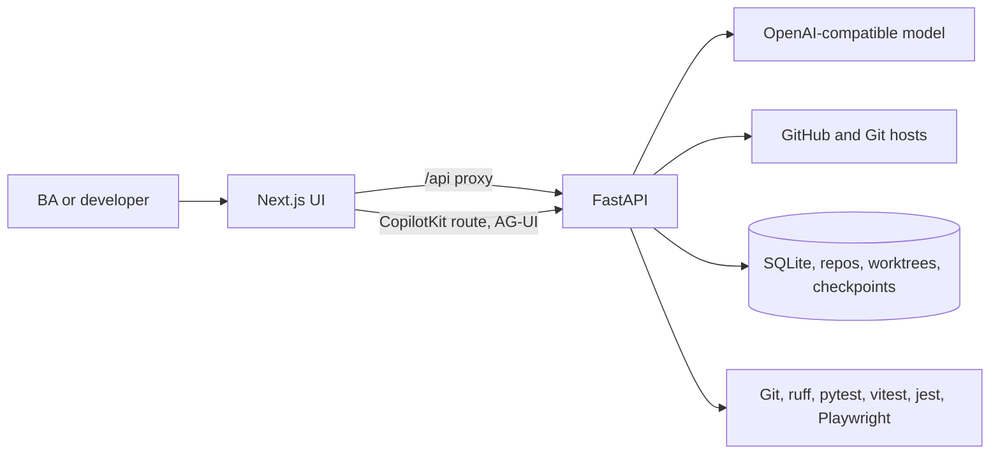
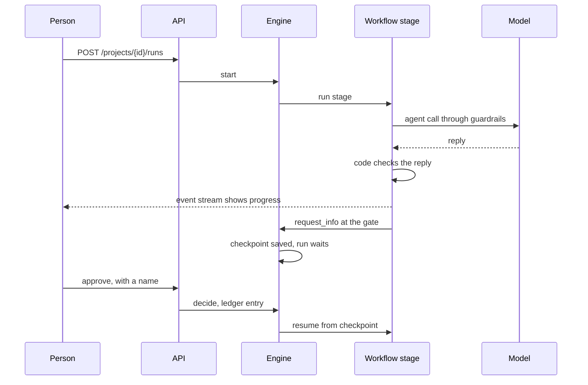
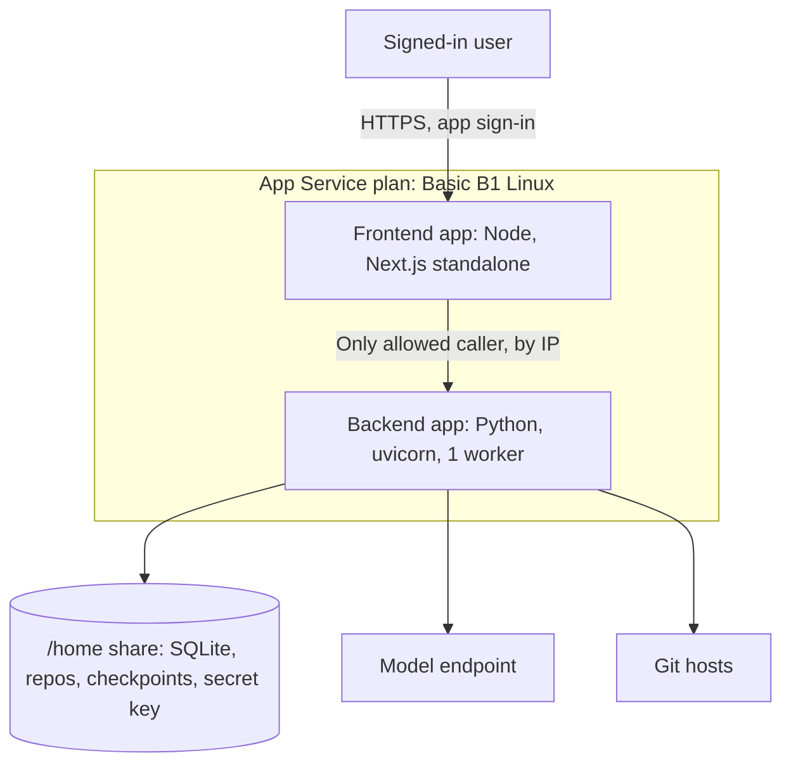

# Agentic QE Platform end-to-end system design

Agentic QE Platform is a workspace on Microsoft Agent Framework (MAF) where everyone signs in and sees only their own projects. `docs/ARCHITECTURE.md` maps each plugin command to its code. This document explains how the whole system fits together and how to extend it. `docs/AZURE_DEPLOY.md` covers deployment.

## System context



## Code layout

Dependencies point one way: `api` calls `maf`, `maf` calls `core`, `repos`, and `qe`. Those three never call upward.

```text
src/backend/
  app.py                 App creation, security middleware, router includes
  config.py, db.py       Settings, SQLite, migrations
  api/                   REST routers
    auth (sign-in, users, account), projects (with members and transfer), repository, documents, templates, runs, findings, governance, settings (models, limits, usage, gate roles), observability, logs, chat
  maf/
    agents/              One file per agent, holding its policy. Scanned into POLICIES, keyed by the file name with hyphens (plugin names)
    tools/               One file per tool, assembled into project-scoped sets
    workflows/           ba, bug_scan, change, qe, plus shared.py and edits.py. Scanned into REGISTRY
    runtime.py           AgentCall, build, ProjectContext, model call limit, JSON repair
    engine.py            MAF WorkflowBuilder wrapper: stages, gates, checkpoints, events
    governance.py        Tool policy, kill switch, guardrails, telemetry
    evals.py, agui.py, llm.py
  core/                  Auth and access, models and limits, typed errors, logs, documents, gates, ledger, prompts, security, Gherkin, files
  repos/                 Git, GitHub, ingest, scan, static analysis
  qe/                    Plan and case validators, runners, traceability
prompts/  evals/  templates/   Versioned text, one file per agent or template
src/frontend/            Next.js UI and the CopilotKit runtime route
deploy/azure/            App Service startup scripts
```

## How to extend it

| To add | Do this | Nothing else changes |
|---|---|---|
| An agent | Add `maf/agents/<key>.py` with a `POLICY`, `prompts/<key>.md`, and `evals/<key>.json` | It appears in the registry, the Agents page, and evals |
| A tool | Add `maf/tools/<name>.py` with `build()`, list it in `tools/__init__.py`, and allow it in the agent's policy | Denied to every other agent by default |
| A workflow | Add `maf/workflows/<name>.py` that ends with `REGISTRY["<name>"] = definition`. Import only the agents and tools it needs | Other workflow files stay untouched |
| An API area | Add `api/<name>.py` with a `router`, and list it in `api/__init__.py` | |

## Core flows

### A workflow with a human gate



### A code change

1. **Prepare.** Create a branch in its own worktree, and run the tests for a baseline.
2. **Implement.** Send the selected code in the message. The agent replies with structured edits and has no tools.
3. **Guard.** `guarded_apply` refuses path escapes, secrets, overwrites, deletions, stray files, and out-of-scope edits. Refusals and current files go back for another round.
4. **Verify.** Run the real tests. Only new failures count. Up to two retries get the failing test files first.
5. **Review.** A confidence review runs beside the tests. If the tests fail, code caps its score at 60. A person sees the verdict, the score, the diff, and any existing assertion the change altered. Nothing is committed until they approve.

### Chat

The browser uses CopilotKit hooks, which call the runtime route, which calls `/agui/agent`. That route runs a MAF agent with the project's tools and streams AG-UI events. Threads and memories are stored per project, and any agent with a chat policy can be selected.

## Why agents edit without tools

On 2026-11-01, tool calls through the configured proxy were measured as unreliable on every model tried, so workflow agents get code in the message and no tools. Agent loops with tools were also measured on `personal-finance-mcp` and failed badly on this model endpoint, which loses older tool results. The agent reread files, drifted to other work, and used 170,000 to 955,000 tokens without finishing. Sending code in the message and applying structured edits finished the same task at about 86,000 tokens, with the real suite passing at 148 tests.

## Harness patterns

Source: [Harness Patterns](https://ashishpatel26.github.io/agent-harness-engineering-pattern/). `plan.md` lists the ones chosen and skipped.

| Harness concern | Pattern | Agentic QE Platform |
|---|---|---|
| Loop limits | Agent loop guards | Tool round limits, token limit per call, token budget per run |
| Model layer | Retry, timeout, structured output, cut-off guard | SDK retry, `ATLAS_MODEL_TIMEOUT`, `AgentCall.typed`, cut-off replies are never parsed |
| Load | Backpressure, bulkhead | `ATLAS_MODEL_CONCURRENCY` limits model calls for the process |
| Tools | Registry, proxy, deny by default | `tools/`, `governance.allowed`, `tool_audit` |
| Safety | Guard chain, append-only history | `guard_text`, hash-chained ledger, immutable versions |
| Durability | Checkpoint and resume | MAF `FileCheckpointStorage` |
| Testing | Scripted stand-in, evals | `tests/scripted_client.py`, `evals/*.json` |

## Trust boundaries

| Boundary | Rule | Enforced by |
|---|---|---|
| Model output | Never trusted alone | Validators, quote checks, Gherkin parser, real test runs |
| Repository and document text | Untrusted data | `neutralize`, `redact`, agents read it as data |
| Agent edits | Confined to a branch | `safe_path`, `guarded_apply` |
| Test code | Cannot see platform secrets | `clean_env` |
| Approvals | Named person only | `gates`, `decide` |
| Network | Loopback locally. On Azure, the backend sits behind an access restriction | Host and origin guard, `session_guard`, App Service |
| Model choice | Must be enabled and ticked for the account doing the work, checked on every call | `auth.permit_model`, `auth.model_for` |
| Roles and members | A viewer cannot write. A gate is signed only by the roles set for it, from the signed-in account | `auth.access_problem`, `auth.gate_signing_problem` |

## Failure handling

| Failure | Behavior |
|---|---|
| Model hangs | The call fails after `ATLAS_MODEL_TIMEOUT` and one retry (`AQE-MODEL-004`). The run fails with a clear error |
| Reply is not valid JSON, or has the wrong fields | `AQE-MODEL-001` or `AQE-MODEL-003`. The rejected reply is saved with the run, and the stage can be retried |
| Reply cut off | Asked again for a shorter answer, up to three attempts. If the last is still cut off, `AQE-MODEL-002` fails the stage |
| Provider content filter | `AQE-MODEL-005`. The error names the block, and text is neutralized before sending |
| Endpoint rejects the key, or is busy or down | `AQE-MODEL-006`. A busy or failing endpoint can be retried |
| Run over budget | Stops at `ATLAS_RUN_TOKEN_LIMIT` (`AQE-ALLOW-001`) |
| Account limit reached | `AQE-ALLOW-002`. The run stops at its next model call and keeps finished batches. Retry failed stage continues after the reset |
| Model not allowed for the account | `AQE-ALLOW-001`. Refused before any call, and the attempt is logged against the account |
| Second run of the same kind in a project | Refused with 409 while one is running or waiting for approval. The message names that run |
| Stage keeps failing | After two earlier failures, `qe_design` and `qe_generate` end with a partial result, which cannot be approved |
| Server restart | Waiting runs resume from checkpoints. Running ones are marked interrupted, and Retry failed stage resumes them |
| No tests ran | The verdict is `INCONCLUSIVE`, never `PASS` |

## Accounts and access

Every API and chat path passes `session_guard` in `app.py`, which denies by default. `core/auth.py` holds the rules: an unknown session gets 401, another owner's item gets 404, and admin areas get 403. Work is charged to the account that starts it. A run keeps its starter, and a chat uses the person who sends the message. Each model call checks that account's dates, allocation, and limits, and that the model is ticked for it. Passwords are salted scrypt hashes, usernames are encrypted, and sessions are stored only as hashes. Every log line passes through `redact()`.

## Models and limits

- Each model is a row in `models`, enabled or not, with one default. Loaded names start disabled, and each has a Test.
- Each account has ticked models (`user_models`) and a default (`users.model`) that must be one of them.
- A call's model is the first of: the run's or chat's choice, the agent's model, the account's default, and the system default. The result must be enabled and ticked for the account.
- Token limits (`user_limits`) apply per account: total allocation, then daily, weekly, and monthly, then per model. Days reset at midnight, weeks on Monday, and months on the 1st, in the zone set in Settings (default Asia/Kolkata).
- Usage is counted from `agent_calls` by the account that started each call. Admin work is never counted against a user.

## Logs

One JSON line per API request, and per warning or error, goes to `data/logs/app-YYYY-MM-DD.jsonl`. A new file starts each day, and files older than `ATLAS_LOG_RETENTION_DAYS` (30 by default) are deleted at start-up and when a new day starts. A line never holds a request body, query string, cookie, or username. The administrator downloads one day with `GET /api/logs?date=YYYY-MM-DD`. `ATLAS_MODEL_NO_CACHE`, on by default, asks the model proxy not to answer from its cache, so a retry is a real retry.

## Accuracy controls

| Stage | Checks by code | Independent review |
|---|---|---|
| Discovery | Required sections, every cited path exists, every source folder covered (`core/doc_checks.py`) | Before the requirements gate, with one automatic revision |
| Requirements | Each quote must exist in the file | Before Gate 1, with one automatic revision |
| Test plan | Plan score and coverage | Before Gate 2, with one automatic revision |
| Test design | Case mix per requirement, duplicates | Per batch of 4 requirements (`DESIGN_BATCH`), before Gate 3 |
| Generated tests | Imports exist, syntax, no placeholders, one case per file. Batches of 10 (`GENERATE_BATCH`) | Before Gate 4 |
| Code change | Baseline comparison, named functions present, assertions flagged | In parallel with the tests. Score capped at 60 when tests fail (`cap_for_failed_tests`) |
| Bug scan | Each quote must exist in the file | Once, on the verified findings |

A review that cannot run shows as **not run**, never as a score.

## Deployment



On each start, the startup scripts compare a stamp, rebuild only what changed, and then serve. `docs/AZURE_SYSTEM_DESIGN.md` has the multi-user target design. Azure has not been deployed for real yet.
