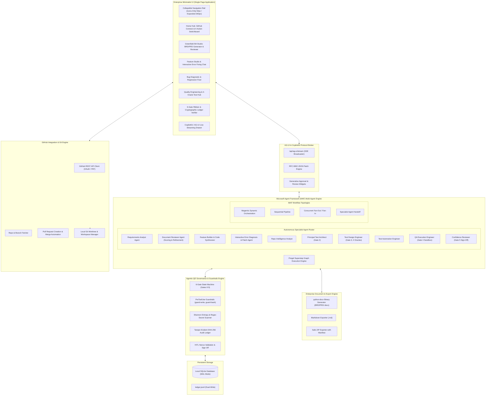

# Agentic QE Platform: System Specifications & Product Architecture

**Document Version:** 2.0.0  
**Product Name:** Agentic QE Platform  
**Specification Standard:** Microsoft Agent Framework (MAF) v1.0 & Agentic-QE Protocol v2.0  
**Status:** Approved Enterprise Product Baseline  

---

## 1. Executive Summary & Product Purpose

**Agentic QE Platform** is an enterprise-grade, local-first, UI-led software quality and development platform. It unifies **autonomous multi-agent orchestration (Microsoft Agent Framework)**, **6-Gate Quality Governance (Agentic-QE)**, and **real-time CopilotKit / AG-UI streaming**.

The platform provides a zero-mock, production-ready environment catering to three core personas:
1. **Business Analysts (Greenfield BA Studio):** Author raw requirements, autonomously generate enterprise-standard **BRD** and **PRD** documents, run an independent **Document Reviewer Agent** for scoring (0–100) and refinement, and export authentic Microsoft Word (`.docx`) and Markdown (`.md`) files.
2. **Developers & Feature Builders:** Connect GitHub accounts, analyze repositories, autonomously scaffold and test features, package local test ZIPs, paste runtime error logs into an interactive Copilot chat for auto-patching, and submit/merge verified GitHub Pull Requests.
3. **Quality Engineers & Governance Leads:** Execute comprehensive test architecture planning, design ISTQB test cases with 4 deterministic oracles, run isolated tests with terminal logs, and maintain an immutable SHA-256 cryptographic audit ledger.

---

## 2. End-to-End System Architecture



---

## 3. Core Functional Modules & Specifications

### 3.1. Collapsible Minimal UI Shell (`CTL-UI-01`)
- **Icon Rail vs Expanded Sidebar:**
  - **Collapsed State (`.sidebar-collapsed`):** Width 64px. Hides brand subtitle, section category headers, and button label text. Displays centered SVG icons with floating HTML5 tooltips.
  - **Expanded State:** Width 260px. Full branding, badges, section headings, and action buttons.
  - **State Persistence:** Toggled via collapse toggle button (`#sidebar-toggle`), stored in browser `localStorage.getItem('agentic_qe.sidebar_collapsed')`.
- **Top Quality Gate Ribbon:** Always visible across all screens, rendering active statuses for Gates 0–5 (`APPROVED`, `PENDING`, `REJECTED`) with one-click review modals.
- **Minimal Enterprise Aesthetics:** Clean dark-mode slate theme, CSS variables for typography (`system-ui`, `-apple-system`), subtle 1px border cards, badge chips, and zero visual clutter.

---

### 3.2. Home Hub & GitHub Integration (`CTL-GIT-01`, `CTL-GIT-02`, `CTL-GIT-03`)
- **GitHub Connection Card:**
  - Input field for GitHub Personal Access Token (PAT) or reads from `GITHUB_TOKEN` environment variable.
  - "Connect & Fetch Repositories" action calls GitHub REST API `GET https://api.github.com/user/repos` with Bearer auth.
  - Displays authenticated user handle, avatar, and a repository dropdown containing all accessible repositories (name, private/public badge, default branch).
  - Allows selecting any repository and branch, auto-cloning or initializing a workspace in `workspaces/{project_id}`.
- **4-Action Primary Switchboard:**
  1. **Add a Feature:** Upload BA document, analyze repo, create feature branch, synthesize code, run tests, download test ZIP, interactive error fix, create & merge PR.
  2. **Scan Repo Bugs & Bug Fix:** Scan repo for vulnerabilities/resource leaks, write regression test, auto-patch code, verify clean run.
  3. **Test Feature or Complete GitHub Repo:** Quality Engineering Hub for 4-oracle ISTQB test generation, pytest execution, and confidence scoring.
  4. **Greenfield BA Studio:** Enterprise BRD, PRD, and User Stories creation, Reviewer Agent critique, and `.docx` / `.md` download.

---

### 3.3. Greenfield BA Document Studio (`CTL-DOC-01`, `CTL-DOC-02`)
- **Strict Document Specifications:**
  - **BRD (Business Requirements Document):**
    1. Executive Summary & Problem Statement
    2. Stakeholder Matrix & User Personas
    3. Current State vs Proposed Future State
    4. Business Scope & Explicit Exclusions
    5. Functional Business Rules (numbered `BR-001` to `BR-nnn`)
    6. Non-Functional Constraints (SLA, compliance, volume)
    7. Success Metrics & ROI KPIs
  - **PRD (Product Requirements Document):**
    1. Product Vision & Strategic Positioning
    2. User Journeys & End-to-End Scenarios
    3. Feature Epic Breakdown & Functional Specifications
    4. Technical Architecture Contracts & API Schemas
    5. Non-Functional Requirements (WCAG, latency, security)
    6. Release Phasing & MVP Milestones
  - **User Stories & Acceptance Criteria:**
    - Standard format: `As a [persona], I want [capability] so that [business value]`.
    - Gherkin format: `Given [context], When [action], Then [observable outcome]`.
    - ISTQB Oracle Classification (`specified`, `derived`, `metamorphic`, `golden`).
- **Autonomous Document Reviewer Agent:**
  - Evaluates documents across 5 weighted dimensions (0–20 each, Total 0–100):
    1. *Completeness & Depth*
    2. *Clarity & Unambiguity*
    3. *Testability & Verifiability*
    4. *Edge Case & Boundary Coverage*
    5. *Security & Compliance Constraints*
  - Outputs structured critique points, identified ambiguities, and missing edge cases.
  - **Iterative Refinement Action:** Click "Refine Document with Recommendations" to automatically regenerate the document addressing all reviewer critique points.
- **Real File Exporter:**
  - **Microsoft Word (`.docx`):** Uses `python-docx` to generate formatted binary `.docx` documents with styled headers, document metadata box, bold lead-ins, and data tables.
  - **Markdown (`.md`):** Clean, standard UTF-8 Markdown download.

---

### 3.4. Autonomous Feature Implementation & Interactive Error Fixing (`CTL-FEAT-01`)
- **Workflow Pipeline:**
  1. User selects repository and uploads or selects a BA feature specification.
  2. **Repo Intelligence Agent** inspects repository files, AST, frameworks, and existing test configurations.
  3. **Feature Builder Agent** generates code changes and creates a dedicated git branch (`feature/{feature-slug}`).
  4. **QA Execution Engineer** executes local tests in a sandboxed subprocess and captures execution logs.
  5. System bundles modified source code into a downloadable ZIP package (`{feature}-local-test.zip`) for manual local developer testing.
- **Interactive Copilot Error Chat:**
  - If the user encounters runtime errors, crashes, or test failures during local testing, they paste the error log/traceback directly into the Feature Workspace Chat.
  - The **Interactive Debugger Agent** analyzes the stack trace, identifies the faulty file and line, applies targeted fixes to the workspace code, re-runs the test suite, and reports the resolution in real time.
- **GitHub Pull Request & Merge Automation:**
  - User reviews file diffs and verified test outputs.
  - Clicking "Create Pull Request" calls GitHub API `POST /repos/{owner}/{repo}/pulls` creating a PR with formatted title, description, acceptance checklist, and test evidence.
  - Clicking "Merge Pull Request" calls GitHub API `PUT /repos/{owner}/{repo}/pulls/{number}/merge`.

---

### 3.5. Quality Engineering 6-Gate Governance Matrix (`CTL-GATE-00` - `05`)

| Gate | Phase Name | Responsible Agent | Enforced Criteria & Prerequisite | Output Evidence |
| :---: | :--- | :--- | :--- | :--- |
| **G0** | Discovery & Context Validation | `RepoIntelligenceAgent` | Scans codebase, languages, dependencies, security flaws. | Repo Analysis JSON & Language Manifest |
| **G1** | Requirements Baseline Approval | `RequirementsAnalystAgent` & `ReviewerAgent` | BRD/PRD synthesized; Reviewer score $\ge 80$; Gherkin acceptance criteria mapped. | Approved BRD/PRD & Story Matrix |
| **G2** | Test Architecture & Risk Strategy | `PrincipalTestArchitect` | Test levels allocated (Unit, API, E2E); risk distribution (P0–P2) established. | Test Strategy Plan & Risk Breakdown |
| **G3** | Test Design & Deterministic Oracles | `TestDesignEngineer` | 4 ISTQB oracles specified (`specified`, `derived`, `metamorphic`, `golden`); boundary cases declared. | Structured Test Cases with Oracles |
| **G4** | Sandboxed Test Execution | `QAExecutionEngineer` | Tests executed in sandboxed subprocess; exit code 0; logs captured. | Test Run Log & Terminal Transcript |
| **G5** | Release Sign-off & Confidence Score | `ConfidenceReviewer` | Composite quality score $\ge 85/100$; zero critical security findings. | Confidence Review Certificate |

---

### 3.6. Security Guardrails & Cryptographic Audit Ledger (`CTL-SEC-01` - `03`, `CTL-AUD-01` - `03`)
- **PreToolUse Write Guard (`guard-write`):** Restricts file modifications strictly within `workspaces/{project_id}`. Rejects `../` path traversal and overwrites of protected files.
- **PreToolUse Shell Guard (`guard-bash`):** Rejects destructive command patterns (`rm -rf`, `shred`, `chmod -R 777`, `curl | bash`, raw disk commands).
- **Secret Scanner:** Scans input/output payloads with Shannon entropy calculation ($H > 4.5$) and regex patterns for private keys, AWS/OpenAI credentials, and bearer tokens.
- **SHA-256 Tamper-Evident Ledger:**
  $$\text{entry\_hash} = \text{SHA-256}(\text{previous\_hash} + \text{sequence\_id} + \text{timestamp} + \text{actor} + \text{action} + \text{details\_json})$$
  Provides instant one-click cryptographic integrity verification verifying zero record tampering across all project events.

---

## 4. UI Screen Wireframes & Screen Mappings

```
+-------------------------------------------------------------------------------------------------------------+
| AGENTIC QE PLATFORM   [Project: PRJ-008 ▼]   [⚡ Live Copilot]   [G0:✓  G1:✓  G2:✓  G3:●  G4:●  G5:●]         |
+-------+-----------------------------------------------------------------------------------------------------+
| [◀/▶] | HOME HUB: GITHUB REPOSITORY & ACTION SWITCHBOARD                                                   |
|       +-----------------------------------------------------------------------------------------------------+
| ◫ Home| [ GitHub Integration: Connected as @octocat ]   [ Selected Repo: octocat/order-service (main) ▼ ]   |
|       +-----------------------------------------------------------------------------------------------------+
| ≡ BA  | [ 1. Add a Feature       ] [ 2. Scan Repo Bugs     ] [ 3. QE & Test Hub      ] [ 4. Greenfield BA  ] |
|   Doc | Upload BA spec, scaffold  | Heuristic bug scan,     | 4-oracle ISTQB suites,  | Author BRD/PRD, run |
|       | code, paste errors, PR.   | regression tests & fix. | sandbox runs & reports. | reviewer, .docx/.md |
| ⌁ Dev +-----------------------------------------------------------------------------------------------------+
|   Feat| RECENT SESSIONS & WORKSPACES                                                                        |
|       | • PRJ-008: Synthetic Order Tracking (Gate 2 Approved)                                               |
| ⚡ QE  | • PRJ-034: Feature - Checkout Payment Retry (PR #142 Merged)                                        |
|   Hub +-----------------------------------------------------------------------------------------------------+
|       | COPILOTKIT / AG-UI LIVE STREAM DRAWER                                                              |
| 🛡 Gov | > [FeatureBuilder] Implementing retry logic in order_service.py...                                  |
|   Ledg| > [User] Error: AssertionError in test_retry_count line 42                                          |
|       | > [InteractiveDebugger] Diagnosed off-by-one error. Applying patch... Tests PASSED!                |
| ⚙ Set | [ Directive or error log to agents...                                          ] [ Send ]           |
+-------+-----------------------------------------------------------------------------------------------------+
```

---

## 5. Formal Control ID Mapping

| Control ID | Category | Description | Primary Implementation File |
| :--- | :--- | :--- | :--- |
| `CTL-UI-01` | User Interface | Collapsible Navigation Sidebar (64px Icons Rail $\leftrightarrow$ 260px Expanded) | `frontend/app.js`, `frontend/styles.css` |
| `CTL-UI-02` | User Interface | Home Hub 4-Action Switchboard | `frontend/app.js` |
| `CTL-GIT-01` | GitHub Integration | GitHub API Authentication & Token Storage | `backend/github/client.py` |
| `CTL-GIT-02` | GitHub Integration | Repository & Branch Listing and Code Fetch | `backend/github/client.py` |
| `CTL-GIT-03` | GitHub Integration | Automated Pull Request Creation & Merge | `backend/github/client.py` |
| `CTL-DOC-01` | BA Document Engine | Enterprise BRD, PRD, and User Stories Synthesis | `backend/ba/doc_generator.py` |
| `CTL-DOC-02` | BA Document Engine | Autonomous Document Reviewer Agent & Refinement | `backend/maf/agents/doc_reviewer.py` |
| `CTL-DOC-03` | BA Document Engine | Microsoft Word (`.docx`) & Markdown (`.md`) File Exporter | `backend/ba/doc_generator.py` |
| `CTL-FEAT-01`| Feature Engineering | Autonomous Feature Implementation & Branching | `backend/maf/agents/feature_builder.py` |
| `CTL-FEAT-02`| Feature Engineering | Interactive Copilot Error Pasting & Patch Engine | `backend/maf/agents/feature_builder.py` |
| `CTL-FEAT-03`| Feature Engineering | Local Test ZIP Exporter with Manifest | `backend/ba/doc_generator.py` |
| `CTL-GATE-00`| Governance | Gate 0: Discovery & Context Validation | `backend/governance/gate_controller.py` |
| `CTL-GATE-01`| Governance | Gate 1: Requirements Baseline Approval | `backend/governance/gate_controller.py` |
| `CTL-GATE-02`| Governance | Gate 2: Test Architecture & Risk Strategy | `backend/governance/gate_controller.py` |
| `CTL-GATE-03`| Governance | Gate 3: Test Design & Deterministic Oracles | `backend/governance/gate_controller.py` |
| `CTL-GATE-04`| Governance | Gate 4: Sandboxed Test Execution | `backend/governance/gate_controller.py` |
| `CTL-GATE-05`| Governance | Gate 5: Release Sign-off & Confidence Score | `backend/governance/gate_controller.py` |
| `CTL-HITL-01`| Security & HITL | PreToolUse Mutation & File Write Guard (`guard-write`) | `backend/governance/guards.py` |
| `CTL-HITL-02`| Security & HITL | PreToolUse Shell Safety Barrier (`guard-bash`) | `backend/governance/guards.py` |
| `CTL-HITL-03`| Security & HITL | Cryptographic Nonce & Approval Queue | `backend/governance/hitl.py` |
| `CTL-SEC-01` | Security & Privacy | Shannon Entropy Secret Scanner | `backend/governance/secret_scanner.py` |
| `CTL-SEC-02` | Security & Privacy | Path Traversal & Workspace Isolation Barrier | `backend/governance/guards.py` |
| `CTL-SEC-03` | Security & Privacy | Subprocess Execution Quotas & Timeout Barrier | `backend/governance/guards.py` |
| `CTL-AUD-01` | Audit & Compliance | SHA-256 Tamper-Evident Hash-Chained Audit Ledger | `backend/governance/ledger.py` |
| `CTL-AUD-02` | Audit & Compliance | State Patch Trail (RFC 6902) & Versioning | `backend/agui/patch.py` |
| `CTL-AUD-03` | Audit & Compliance | Exportable Verification & Compliance Package | `backend/app.py` |
